= Etapa 1: Prepare-se para adicionar o compartimento de unidades
:allow-uri-read: 

.Antes de começar
* Devido à complexidade deste procedimento, leia todas as etapas antes de iniciar o procedimento.
+
Ao adicionar um compartimento de expansão a um ou mais compartimentos existentes, para manter a integridade do sistema durante o procedimento, você deve sempre manter um caminho ativo. Você deve seguir o procedimento exatamente na ordem apresentada.

+
Para cabear o novo compartimento, você deve refazer os cabos das conexões do controlador para o compartimento do lado A (compartimento IOM A) e adicionar conexões entre compartimentos, verificar se o caminho do lado A está ativo, refazer os cabos das conexões do controlador para o compartimento do lado B (compartimento IOMB) e adicionar conexões entre compartimentos, e então verificar se a redundância foi restabelecida.

+

NOTE: Se você estiver instalando um compartimento de expansão que já foi instalado anteriormente em um sistema de storage, este procedimento requer etapas adicionais que você deve seguir.

* Certifique-se de que a adição de um compartimento de unidade é o procedimento que você precisa.
* Verifique se o seu sistema de storage está executando uma versão do SANtricity que suporta compartimentos de expansão SAS e se você não excede o número máximo de compartimentos SAS suportados.
+
Para obter informações sobre as versões suportadas do SANtricity e o número máximo de compartimentos de expansão SAS suportados para o seu sistema de storage, consulte o NetApp Hardware Universe: https://hwu.netapp.com/Controller/Index?platformTypeId=2357027["Hardware Universe"^].

+

NOTE: Os sistemas de storage EF50 e EF80 que executam o SANtricity 12.10 ou posterior suportam compartimentos de expansão SAS.

* Seu sistema de storage deve ter portas SAS disponíveis. Isso significa que os módulos de E/S SAS já devem estar instalados. Se não estiverem, use o procedimento aplicável para instalar os módulos de E/S SAS e, em seguida, retorne a este procedimento para adicionar o compartimento de expansão a quente.
+
** Para os sistemas de storage EF50 e EF80, use o link:../maintenance-ef50-ef80/io-module-upgrade.html["Atualizar módulos de E/S"^] procedimento.
** Para sistemas de storage mais antigos, utilize o procedimento _SAS expansion cards_ para o modelo do seu sistema de storage na seção _Maintain systems_.

.Sobre esta tarefa
* Este procedimento se aplica a um compartimento de controlador E2800, E2800B, EF280, E5700, E5700B, EF570, EF300, EF600, EF300C, EF600C, E4000, EF50 ou EF80.
+

NOTE: Se você estiver instalando cabos em um compartimento de controladora mais antigo, consulte  https://mysupport.netapp.com/ecm/ecm_download_file/ECMLP2859057["Adição de gavetas de unidade IOM a uma gaveta de controladora E27XX, E56XX ou EF560 existente"^].

* Este procedimento aplica-se à adição a quente de compartimentos de unidades DE212C, DE224C ou DE460C com módulos IOM12, IOM12B ou IOM12C.
+

NOTE: Os módulos IOM12C são suportados somente no SANtricity OS 11.90R3 em diante. Certifique-se de que o firmware do controlador foi atualizado antes de instalar ou atualizar para um IOM12C.

[[step-1-prepare-to-add-the-drive-shelf]]
== Etapa 1: Prepare-se para adicionar o compartimento de unidades

Para se preparar para adicionar um compartimento de unidade em tempo real, você deve verificar se há eventos críticos e verificar o status das IOMs.

.Antes de começar
* A fonte de alimentação do seu sistema de storage deve ser capaz de acomodar os requisitos de energia do novo compartimento de unidades. Para obter a especificação de energia para o compartimento de unidades, consulte https://hwu.netapp.com/Controller/Index?platformTypeId=2357027["Hardware Universe"^] .
* O padrão de cabeamento do sistema de storage existente deve corresponder a um dos esquemas aplicáveis mostrados neste procedimento.

.Passos
. No Gerenciador do sistema SANtricity, selecione *suporte* > *Centro de suporte* > *Diagnóstico*.
. Selecione *coletar dados de suporte*.
+
A caixa de diálogo coletar dados de suporte é exibida.

. Clique em *Collect*.
+
O arquivo é salvo na pasta Downloads do navegador com o nome support-data.7z. Os dados não são enviados automaticamente para o suporte técnico.

. Selecione *Support* > *Event Log*.
+
A página Registro de eventos exibe os dados do evento.

. Selecione o cabeçalho da coluna *Priority* para classificar eventos críticos no topo da lista.
. Revise os eventos críticos do sistema para ver se ocorreram nas últimas duas a três semanas e verifique se quaisquer eventos críticos recentes foram resolvidos ou solucionados de outra forma.
+

NOTE: Se ocorrerem eventos críticos não resolvidos nas duas ou três semanas anteriores, interrompa o procedimento e contacte o suporte técnico. Continue o procedimento apenas quando o problema for resolvido.

. Se você tiver IOMs conetados ao seu hardware, execute as etapas a seguir. Caso contrário, vá para <<step2_install_drive_shelf,Etapa 2: Instale o compartimento de unidades e aplique energia.>>
+
.. Selecione o menu: Hardware [Controllers and components].
.. Selecione o ícone *IOMs (ESMs)*.
+
image::../media/sam1130_ss_hardware_iom_icon.gif[Ícone de IOMs (ESMs)]

+
A caixa de diálogo Configurações do componente do compartimento é exibida com a guia *IOMs (ESMs)* selecionada.

.. Certifique-se de que o status mostrado para cada IOM/ESM é _Optimal_.
.. Clique em *Mostrar mais configurações*.
.. Confirme se existem as seguintes condições:
+
*** O número de ESMs/IOMs detetados corresponde ao número de ESMs/IOMs instalados no sistema e ao de cada compartimento de unidades.
*** Ambos os ESMs/IOMs mostram que a comunicação está OK.
*** A taxa de dados é de 12GB GB/s para compartimentos de unidades DE212C, DE224C e DE460C ou 6 GB/s para outras bandejas de unidades.

[[step-2-install-the-drive-shelf-and-apply-power]]
[[step2_install_drive_shelf]]
== Etapa 2: Instale o compartimento de unidades e aplique energia

Instale um novo compartimento de unidade ou um compartimento de unidade instalado anteriormente, ligue a alimentação e verifique se há LEDs que exijam atenção.

.Passos
. Se você estiver instalando um compartimento de unidade que tenha sido instalado anteriormente em um sistema de storage, remova as unidades. As unidades devem ser instaladas uma de cada vez mais tarde neste procedimento.
+
Se o histórico de instalação do compartimento de unidades que você está instalando for desconhecido, você deve pressupor que ele foi instalado anteriormente em um sistema de armazenamento.

. Instale o compartimento de unidades no rack que contém os componentes do sistema de armazenamento.
+

NOTE: Consulte as instruções de instalação do seu modelo para obter o procedimento completo para instalação física e cabeamento de energia. As instruções de instalação para o seu modelo incluem notas e avisos que você deve levar em conta para instalar com segurança uma prateleira de unidade.

. Ligue o novo compartimento de unidades e confirme se nenhum LED âmbar de atenção está aceso no compartimento de unidades. Se possível, resolva quaisquer condições de avaria antes de continuar com este procedimento.

[[step-3-cable-the-drive-shelf]]
== Passo 3: Conecte o cabo ao compartimento de expansão

Para conectar o compartimento de expansão ao seu sistema de storage, você conecta cada controlador de forma que eles tenham um caminho do lado A (IOMA) e um caminho do lado B (IOMB) para o único compartimento de expansão ou para a cadeia de compartimentos de expansão (conforme aplicável). E se você tiver uma cadeia de compartimentos de expansão, você conecta os compartimentos de expansão entre si (conexões entre compartimentos) através do caminho do lado A e do caminho do lado B.

Você sempre conecta os cabos dos controladores e de um ou mais compartimentos de forma que haja duas conexões de cabo para o caminho do lado A (IOMA) e para o caminho do lado B (IOMB), conforme mostrado nas ilustrações de cabeamento.

[role="tabbed-block"]
====
.Conecte o compartimento de unidades para o EF50 ou o EF80
--
Este procedimento instrui você sobre como adicionar a SAS compartimento de expansão ao seu sistema de storage EF50 ou EF80 e como recabeá-lo para adicionar a quente uma segunda prateleira; no entanto, este procedimento também pode ser aplicado ao adicionar prateleiras adicionais.

.Antes de começar
Atualizou o firmware para a versão mais recente. Para atualizar o firmware, siga as instruções no link:../upgrade-santricity/index.html["Atualizando o SANtricity os"].

.Sobre esta tarefa
* Se você estiver adicionando um compartimento de expansão extra a um ou mais compartimentos de expansão já existentes, o seguinte se aplica:
+
** Este procedimento consiste em refazer a fiação das conexões do controlador ao compartimento, de forma que você sempre mantenha um caminho ativo para o compartimento do controlador.
+
Para manter um caminho ativo durante este procedimento, você refaz a fiação das conexões do controlador para o compartimento do lado A (shelf IOMA) e adiciona conexões entre compartimentos, verifica se o caminho do lado A está ativo, refaz a fiação das conexões do controlador para o compartimento do lado B (shelf IOMB) e adiciona conexões entre compartimentos e, em seguida, verifica se a redundância foi restabelecida.

** Você sempre move os cabos do último compartimento de expansão da cadeia para os mesmos IOMs e portas IOM no novo compartimento de expansão e, em seguida, conecta o novo compartimento de expansão ao compartimento de expansão anterior, o último da cadeia (conexões entre compartimentos de expansão).

* Este procedimento inclui etapas para adicionar até dois compartimentos de expansão com o equipamento em funcionamento. No entanto, se você estiver adicionando um compartimento de expansão adicional, comece pela etapa 2 e aplique as etapas ao compartimento de expansão adicional.
* Este procedimento mostra controladores com um módulo de E/S SAS no slot 3. Para ver todas as configurações de módulo de E/S SAS suportadas, consulte link:https://hwu.netapp.com["NetApp Hardware Universe"^].
* Nas ilustrações de cabeamento, as conexões do controlador A são mostradas em azul e as conexões do controlador B em vermelho. As linhas tracejadas (azul e vermelha) representam o cabeamento existente que você está movendo para realizar as etapas de cabeamento. As portas e linhas cinza representam o cabeamento existente que permanece no local enquanto você realiza as etapas de cabeamento.

.Passos
. Para adicionar dinamicamente um compartimento de expansão SAS que seja o compartimento de expansão SAS inicial, conclua as seguintes subetapas; caso contrário, vá para a próxima etapa.
+
.. Conecte a porta 3a do controlador A à porta 1 do shelf IOMA.
.. Conecte a porta 3b do controlador A à porta 2 do compartimento IOMA.
.. Conecte a porta 3c do controlador A à porta 3 do compartimento IOMB.
.. Conecte a porta 3d do controlador A à porta 4 do compartimento IOMB.
.. Conecte a porta 3a do controlador B à porta 3 do compartimento IOMA.
.. Conecte a porta 3b do controlador B à porta 4 do IOMA do compartimento.
.. Conecte a porta 3c do controlador B à porta 1 do IOMB do compartimento.
.. Conecte a porta 3d do controlador B à porta 2 do IOMB do compartimento.
+
Quando você terminar de passar os cabos no compartimento, a fiação deve ficar como a seguir:

+
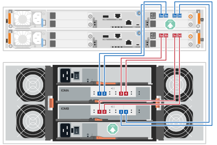

. Para adicionar a quente um segundo compartimento de expansão SAS (compartimento 2), recabe as conexões do controlador para o compartimento no lado A e adicione as conexões entre compartimentos no lado A, conforme descrito a seguir; caso contrário, vá para a próxima etapa.
+
.. Desconecte o cabo da porta IOMA 1 do compartimento 1 e reconecte-o à porta IOMA 1 do compartimento 2.
.. Desconecte o cabo da porta IOMA 2 do compartimento 1 e reconecte-o à porta IOMA 2 do compartimento 2.
.. Conecte a porta IOMA 1 do compartimento 1 à porta IOMA 4 do compartimento 2.
.. Conecte a porta IOMA 2 do compartimento 1 à porta IOMA 3 do compartimento 2.
+
Quando você terminar de reconectar os cabos do lado A, a fiação deverá ficar como a seguir:

+
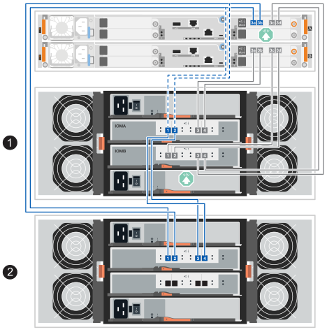

. No SANtricity System Manager, clique em menu:Hardware[Controllers and components].
+

NOTE: Se você estiver adicionando um segundo SAS compartimento de expansão, neste ponto do procedimento, você terá apenas um caminho ativo para o compartimento do controlador.

. Role para baixo, conforme necessário, para ver todos os compartimentos de unidades no novo sistema de storage. Se o novo compartimento de unidades não for exibido, resolva o problema de conexão.
. Selecione o ícone *ESMs/IOMs* para o novo compartimento de unidades.
+
image::../media/sam1130_ss_hardware_iom_icon.gif[Ícone ESMs/IOMs]

+
A caixa de diálogo *Shelf Component Settings* é exibida.

. Selecione a guia *ESMs/IOMs* na caixa de diálogo *Configurações do componente de prateleira*.
. Selecione *Mostrar mais opções* e verifique o seguinte:
+
** Se você estiver adicionando o primeiro compartimento de expansão SAS, IOM/ESM A e IOM/ESM B serão listados. Se você estiver adicionando um segundo compartimento de expansão SAS, IOM/ESM A será listado.
** A taxa de dados atual é de 12 Gbps para um compartimento de unidades SAS-3.
** As comunicações do cartão estão OK.

. Se você estiver adicionando um segundo compartimento de expansão SAS, recableie as conexões do controlador para o compartimento do lado B e adicione as conexões entre os compartimentos do lado B, conforme descrito a seguir; caso contrário, vá para a etapa 10.
+
.. Desconecte o cabo da porta IOMB 1 do compartimento 1 e reconecte-o à porta IOMB 1 do compartimento 2.
.. Desconecte o cabo da porta IOMB 2 do compartimento 1 e reconecte-o à porta IOMB 2 do compartimento 2.
.. Conecte a porta IOMB 1 do compartimento 1 à porta IOMB 3 do compartimento 2.
.. Conecte a porta IOMB 2 do compartimento 1 à porta IOMB 4 do compartimento 2.
+
Quando você terminar de recabelar as conexões do lado B, a fiação deverá ficar como a seguinte:

+
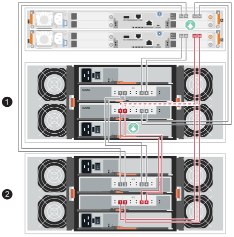

. Se você estiver adicionando um segundo SAS compartimento de expansão, após concluir o recabeamento dos dois compartimentos, o cabeamento deverá ter a seguinte aparência:
+

NOTE: Se você estiver adicionando a quente um terceiro compartimento a uma pilha de dois compartimentos, o cabeamento deve ser semelhante à ilustração na link:../install-hw-ef50-ef80/install-cable.html#step-3-cable-the-sas-shelf-connections["Opção 2: aba com três compartimentos DE460C"^] seção _Cable the SAS shelf connections_ para novas instalações de sistema.

+
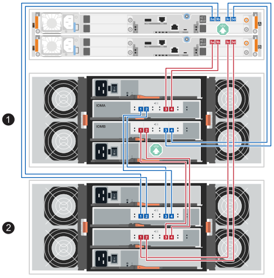

. Se ainda não estiver selecionado, selecione a guia *ESMs/IOMs* na caixa de diálogo *Configurações do componente de prateleira* e, em seguida, selecione *Mostrar mais opções*. Verifique se as comunicações do cartão são *SIM*.
+

NOTE: O status ideal indica que o erro de perda de redundância associado ao novo compartimento de unidades foi resolvido e o sistema de armazenamento está estabilizado.

--
.Conete o compartimento de unidades para E2800 ou E5700
--
Você conecta o compartimento de unidades ao controlador A, confirma o status IOM e, em seguida, conecta o compartimento de unidades à controladora B.

.Passos
. Conete o compartimento de unidades ao controlador A.
+
A figura a seguir mostra um exemplo de conexão entre um compartimento de unidade adicional e o controlador A. para localizar as portas no modelo, consulte o https://hwu.netapp.com/Controller/Index?platformTypeId=2357027["Hardware Universe"^].

+
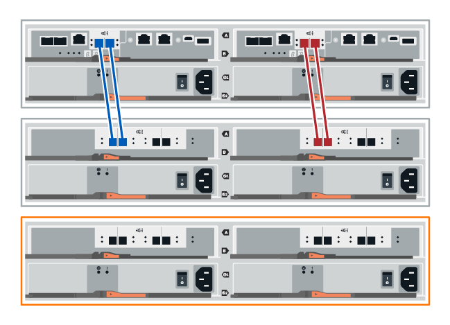

+
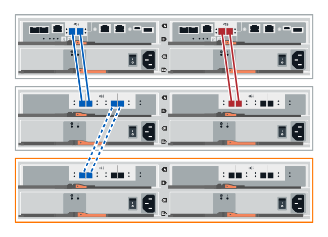

. No Gerenciador do sistema SANtricity, clique em *hardware*.
+

NOTE: Neste ponto do procedimento, você tem apenas um caminho ativo para o compartimento da controladora.

. Role para baixo, conforme necessário, para ver todos os compartimentos de unidades no novo sistema de storage. Se o novo compartimento de unidades não for exibido, resolva o problema de conexão.
. Selecione o ícone *ESMs/IOMs* para o novo compartimento de unidades.
+
image::../media/sam1130_ss_hardware_iom_icon.gif[Ícone ESMs/IOMs]

+
A caixa de diálogo *Shelf Component Settings* é exibida.

. Selecione a guia *ESMs/IOMs* na caixa de diálogo *Configurações do componente de prateleira*.
. Selecione *Mostrar mais opções* e verifique o seguinte:
+
** IOM/Esm A está na lista.
** A taxa de dados atual é de 12 Gbps para um compartimento de unidades SAS-3.
** As comunicações do cartão estão OK.

. Desconete todos os cabos de expansão do controlador B.
. Conete o compartimento de unidades ao controlador B.
+
A figura a seguir mostra um exemplo de conexão entre um compartimento de unidade adicional e o controlador B. para localizar as portas no modelo, consulte o https://hwu.netapp.com/Controller/Index?platformTypeId=2357027["Hardware Universe"^].

+
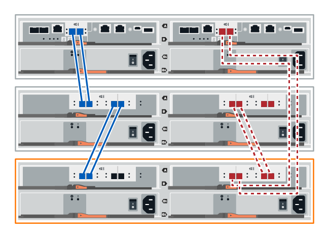

. Se ainda não estiver selecionado, selecione a guia *ESMs/IOMs* na caixa de diálogo *Configurações do componente de prateleira* e, em seguida, selecione *Mostrar mais opções*. Verifique se as comunicações do cartão são *SIM*.
+

NOTE: O status ideal indica que o erro de perda de redundância associado ao novo compartimento de unidades foi resolvido e o sistema de armazenamento está estabilizado.

--
.Conete o compartimento de unidades para EF300 ou EF600
--
Você conecta o compartimento de unidades ao controlador A, confirma o status IOM e, em seguida, conecta o compartimento de unidades à controladora B.

.Antes de começar
* Atualizou o firmware para a versão mais recente. Para atualizar o firmware, siga as instruções no link:../upgrade-santricity/index.html["Atualizando o SANtricity os"].

.Passos
. Desconete os dois cabos do controlador do lado A das IOM12 portas uma e duas da última gaveta anterior na stack e, em seguida, conete-os à nova gaveta IOM12 portas uma e duas.
+
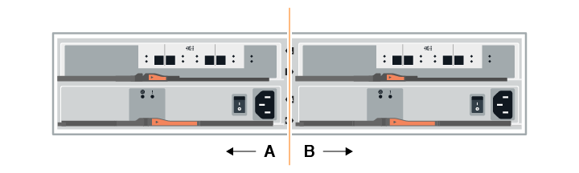

. Conete os cabos às portas IOM12 três e quatro do lado A da nova gaveta às portas IOM12 do último compartimento anterior uma e duas.
+
A figura a seguir mostra um exemplo de conexão para um lado entre um compartimento de unidade adicional e o último compartimento anterior. Para localizar as portas no modelo, consulte https://hwu.netapp.com/Controller/Index?platformTypeId=2357027["Hardware Universe"^] .

+
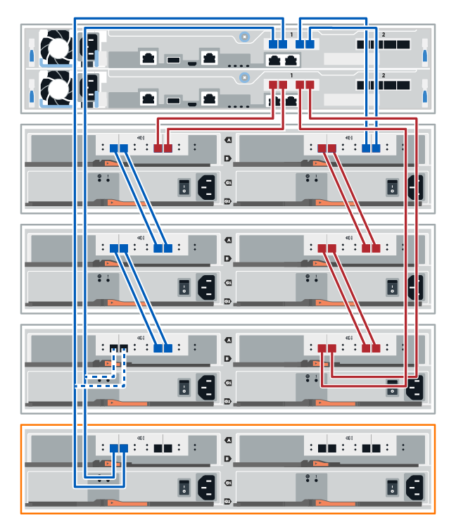

+
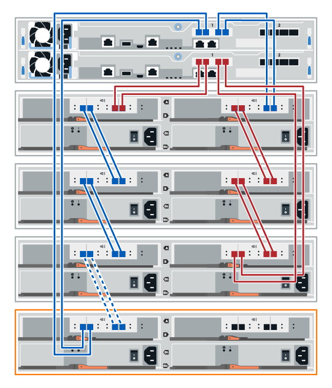

. No SANtricity System Manager, clique em menu:Hardware[Controllers and components].
+

NOTE: Neste ponto do procedimento, você tem apenas um caminho ativo para o compartimento da controladora.

. Role para baixo, conforme necessário, para ver todos os compartimentos de unidades no novo sistema de storage. Se o novo compartimento de unidades não for exibido, resolva o problema de conexão.
. Selecione o ícone *ESMs/IOMs* para o novo compartimento de unidades.
+
image::../media/sam1130_ss_hardware_iom_icon.gif[Ícone ESMs/IOMs]

+
A caixa de diálogo *Shelf Component Settings* é exibida.

. Selecione a guia *ESMs/IOMs* na caixa de diálogo *Configurações do componente de prateleira*.
. Selecione *Mostrar mais opções* e verifique o seguinte:
+
** IOM/Esm A está na lista.
** A taxa de dados atual é de 12 Gbps para um compartimento de unidades SAS-3.
** As comunicações do cartão estão OK.

. Desconete os dois cabos do controlador do lado B das IOM12 portas uma e duas da última gaveta anterior na stack e, em seguida, conete-os às novas portas da gaveta IOM12 uma e duas.
. Conete os cabos às portas IOM12 do lado B três e quatro da nova gaveta às portas IOM12 do último compartimento anterior uma e duas.
+
A figura a seguir mostra um exemplo de conexão para o lado B entre um compartimento de unidade adicional e o último compartimento anterior. Para localizar as portas no modelo, consulte https://hwu.netapp.com/Controller/Index?platformTypeId=2357027["Hardware Universe"^] .

+
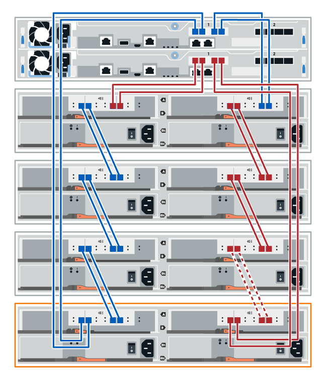

. Se ainda não estiver selecionado, selecione a guia *ESMs/IOMs* na caixa de diálogo *Configurações do componente de prateleira* e, em seguida, selecione *Mostrar mais opções*. Verifique se as comunicações do cartão são *SIM*.
+

NOTE: O status ideal indica que o erro de perda de redundância associado ao novo compartimento de unidades foi resolvido e o sistema de armazenamento está estabilizado.

--
.Conete o compartimento de unidades para E4000
--
Você conecta o compartimento de unidades ao controlador A, confirma o status IOM e, em seguida, conecta o compartimento de unidades à controladora B.

.Passos
. Conete o compartimento de unidades ao controlador A.
+
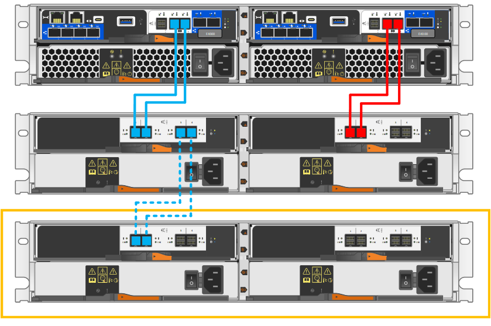

. No SANtricity System Manager, clique em menu:Hardware[Controllers and components].
+

NOTE: Neste ponto do procedimento, você tem apenas um caminho ativo para o compartimento da controladora.

. Role para baixo, conforme necessário, para ver todos os compartimentos de unidades no novo sistema de storage. Se o novo compartimento de unidades não for exibido, resolva o problema de conexão.
. Selecione o ícone *ESMs/IOMs* para o novo compartimento de unidades.
+
image::../media/sam1130_ss_hardware_iom_icon.gif[Ícone de hardware IOM]

+
A caixa de diálogo *Shelf Component Settings* é exibida.

. Selecione a guia *ESMs/IOMs* na caixa de diálogo *Configurações do componente de prateleira*.
. Selecione *Mostrar mais opções* e verifique o seguinte:
+
** IOM/Esm A está na lista.
** A taxa de dados atual é de 12 Gbps para um compartimento de unidades SAS-3.
** As comunicações do cartão estão OK.

. Desconete todos os cabos de expansão do controlador B.
. Conete o compartimento de unidades ao controlador B.
+
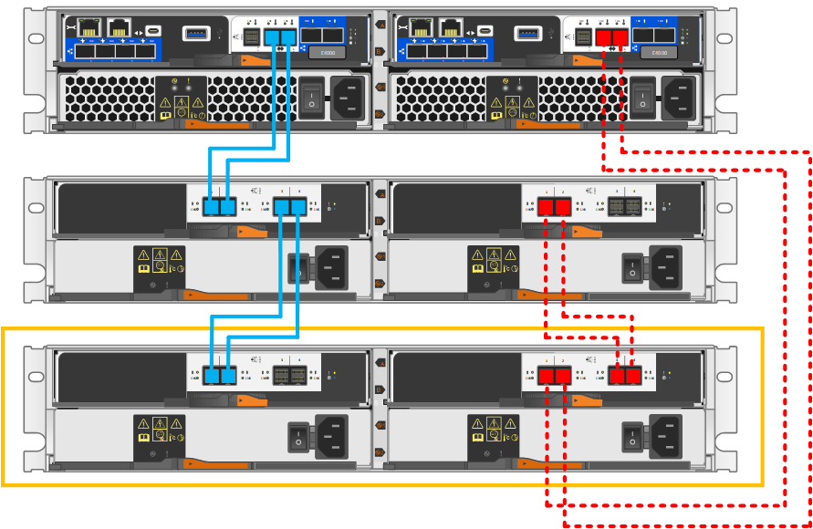

. Se ainda não estiver selecionado, selecione a guia *ESMs/IOMs* na caixa de diálogo *Configurações do componente de prateleira* e, em seguida, selecione *Mostrar mais opções*. Verifique se as comunicações do cartão são *SIM*.
+

NOTE: O status ideal indica que o erro de perda de redundância associado ao novo compartimento de unidades foi resolvido e o sistema de armazenamento está estabilizado.

--
====

[[step-4-assign-drive-shelf-ids]]
== Etapa 4: Atribua IDs aos compartimentos de expansão

Ligue os compartimentos e, em seguida, atribua IDs exclusivos a cada compartimento.

.Sobre esta tarefa
* Atribuir um ID de compartimento exclusivo a cada compartimento garante que ele seja distinto dentro do seu sistema de storage.
+
Um ID de compartimento válido é de 01 a 99.

+
As prateleiras internas (storage), que estão integradas nos controladores, recebem um ID de prateleira fixo de 00.

* Você deve reinicializar o compartimento (desligue o interruptor de energia em cada uma das fontes de alimentação do compartimento SAS, aguarde pelo menos 10 segundos e, em seguida, ligue novamente) para que o ID do compartimento entre em vigor.

.Passos
. Remova a tampa da extremidade esquerda para acessar o botão laranja de identificação do compartimento no painel frontal.
+
image::../media/drw_shelf_id_sas_ieops-2187.svg[Alterar ID do compartimento SAS]

+
[cols="20%,80%"]
|===

 a| 
image::../media/icon_round_1.png[Chamada número 1]
 a| 
Tampa da extremidade da prateleira

 a| 
image::../media/icon_round_2.png[Chamada número 2]
 a| 
Placa frontal do compartimento

 a| 
image::../media/icon_round_3.png[[Chamada número 3]
 a| 
Botão de identificação da prateleira

 a| 

 a| 
Número de identificação da prateleira

|===
. Altere o primeiro número do ID do compartimento:
+
.. Pressione e mantenha pressionado o botão de identificação do compartimento de expansão até que o primeiro número no visor digital pisque e, em seguida, solte o botão.
+
O número pode demorar até 15 segundos para piscar. Isso ativa o modo de programação do ID do compartimento.

+

NOTE: Se o indicador de identificação demorar mais de 15 segundos para piscar, pressione e segure o botão de identificação do compartimento novamente, certificando-se de pressioná-lo completamente.

.. Pressione e solte o botão de identificação do compartimento para avançar o número até atingir o número desejado de 0 a 9.
+
Cada ciclo de pressionamento e liberação pode durar apenas um segundo.

+
O primeiro número continua piscando.

. Altere o segundo número do ID do compartimento:
+
.. Pressione e mantenha pressionado o botão até que o segundo número no visor digital pisque.
+
Pode levar até três segundos para o número piscar.

+
O primeiro número no visor digital para de piscar.

.. Pressione e solte o botão de identificação do compartimento para avançar o número até atingir o número desejado de 0 a 9.
+
O segundo número continua piscando.

. Confirme o número desejado e saia do modo de programação pressionando e mantendo pressionado o botão de identificação do compartimento de expansão até que o segundo número pare de piscar.
+
Pode levar até três segundos para o número parar de piscar.

+
Os dois números no visor digital começam a piscar e o LED âmbar acende após cerca de cinco segundos, alertando você de que o ID do compartimento pendente ainda não entrou em vigor.

. Desligue e ligue o compartimento por pelo menos 10 segundos para que o ID do compartimento entre em vigor.
+
.. Desligue o interruptor de alimentação de cada uma das fontes de alimentação.
.. Aguarde 10 segundos.
.. Ligue o interruptor de alimentação em cada uma das fontes de alimentação para concluir o ciclo de energia.
+
Quando a fonte de alimentação é ligada, o LED bicolor deve acender em verde.

. Recoloque a tampa da extremidade esquerda.

[[step-5-complete-the-hot-add]]
== Etapa 5: conclua o adicionar sem desligamento

Você conclui o hot add verificando se há erros e confirmando que o compartimento de unidade recém-adicionado usa o firmware mais recente.

.Passos
. No Gerenciador do sistema SANtricity, clique em *Início*.
. Se o link rotulado *Recover from problems* aparecer na parte superior central da página, clique no link e resolva quaisquer problemas indicados no Recovery Guru.
. No SANtricity System Manager, clique em menu:Hardware[Controllers and components] e role para baixo, se necessário, para ver a gaveta de unidades recém-adicionada.
. Para unidades que foram instaladas anteriormente em um sistema de storage diferente, adicione uma unidade de vez ao compartimento de unidades recém-instalado. Aguarde que cada unidade seja reconhecida antes de inserir a próxima unidade.
+
Quando uma unidade é reconhecida pelo sistema de armazenamento, a representação do slot da unidade na página *hardware* é exibida como um retângulo azul.

. Selecione *Support* > *Support Center* > *Support Resources* tab.
. Clique no link *Inventário de software e firmware* e verifique quais versões do firmware IOM/ESM e do firmware da unidade estão instaladas no novo compartimento de unidades.
+

NOTE: Talvez seja necessário rolar a página para localizar esse link.

. Se necessário, atualize o firmware da unidade.
+
O firmware IOM/ESM é atualizado automaticamente para a versão mais recente, a menos que você tenha desativado o recurso de atualização.

.O que se segue?
O procedimento de adição a quente está concluído. Pode retomar as operações normais.
