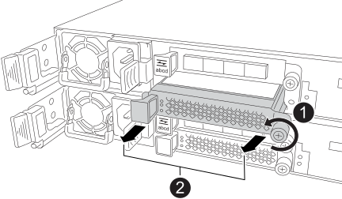

= 
:allow-uri-read: 

.Sobre esta tarefa
* Você começa com um controlador e, em seguida, repete os passos para o outro controlador.
* A ilustração mostra a remoção de um módulo de E/S do slot 2. Dependendo do tipo de módulo de E/S para o qual você está atualizando, o slot pode ser diferente.

.Passos
. Se você ainda não está aterrado, aterre-se adequadamente.
. Em um dos controladores, desconecte o cabeamento do módulo de E/S que você está removendo, a menos que seja um módulo de bloqueio de E/S.
+
Você pode etiquetar os cabos para saber de onde vieram. No entanto, dependendo do tipo de módulo de E/S para o qual você está atualizando, talvez você não esteja recablando para as mesmas portas ou talvez não seja possível reutilizar os mesmos cabos.

. Remova o módulo de E/S ou o módulo de E/S em branco do slot de destino.
+
A ilustração a seguir mostra um módulo de blanking de E/S sendo removido.

+

+
[cols="1,4"]
|===

 a| 
image:../media/icon_round_1.png["Chamada número 1"]
 a| 
No módulo de E/S ou no módulo de bloqueio de E/S, gire o parafuso de aperto manual no sentido anti-horário para soltar.

 a| 
image:../media/icon_round_2.png["Chamada número 2"]
 a| 
Retire o módulo de I/O ou o módulo de bloqueio de I/O do controlador usando a aba à esquerda e o parafuso de aperto manual.

|===
. Desembale o novo módulo de E/S e coloque-o em uma superfície plana e livre de estática perto do sistema de storage.
. Instale o novo módulo de E/S:
+
.. Alinhe o módulo de E/S com as bordas da abertura do slot do controlador.
.. Empurre cuidadosamente o módulo de E/S até o fundo do slot, certificando-se de encaixar corretamente o módulo no conector.
+
Você pode usar a aba à esquerda e o parafuso de aperto manual para empurrar o módulo de E/S.

.. Gire o parafuso de aperto manual no sentido horário para apertar.

. Conecte o módulo de E/S à rede do host ou ao compartimento de expansão SAS.
+
** Para o cabeamento de rede do host, você pode usar a link:../install-hw-ef50-ef80/install-cable.html["Conecte o hardware"^] seção do conteúdo de instalação e configuração do sistema para cabeamento de rede do host.
** Para a fiação do compartimento de expansão SAS, você pode usar o link:../install-hw-cabling/hotadd-drive-shelf-task.html["Adicione a quente um compartimento para unidades de disco em um sistema de storage E-Series"^] procedimento.

. Repita estas etapas para atualizar um módulo de E/S no outro controlador.

