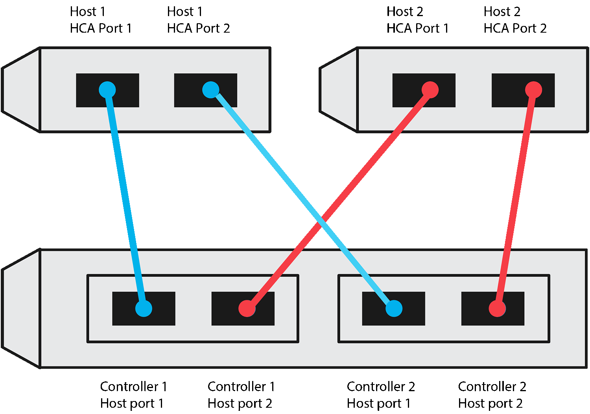
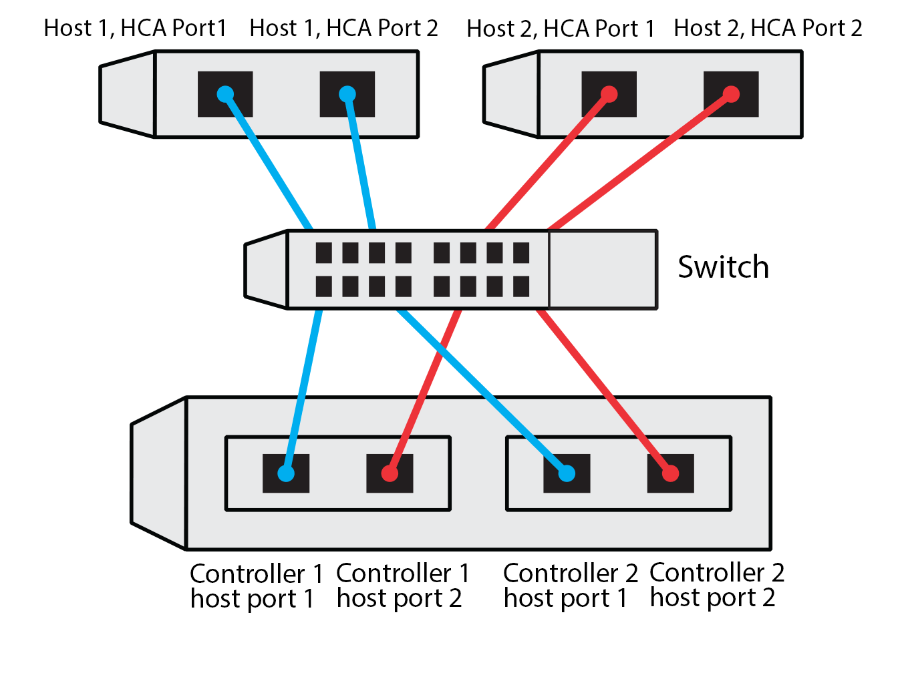

= Planilha de configuração de NVMe over TCP para hosts Linux E-Series
:allow-uri-read: 
:icons: font
:imagesdir: ../media/

[role="lead"]
Você pode gerar e imprimir um PDF desta página e, em seguida, usar a planilha a seguir para registrar as informações de configuração de storage NVMe over TCP. Você precisará dessas informações para executar tarefas de provisionamento.

[[direct-connect-topology]]
== Topologia de conexão direta

Em uma topologia de conexão direta, um ou mais hosts são conectados diretamente ao subsistema. Na versão 11.50 do SANtricity OS, oferecemos suporte a uma única conexão de cada host a um controlador de subsistema, conforme mostrado abaixo. Nessa configuração, uma porta de placa de interface de rede (NIC) de cada host deve estar na mesma sub-rede que a porta do controlador E-Series à qual está conectada, mas em uma sub-rede diferente da outra porta NIC.

Um exemplo de configuração que satisfaz os requisitos consiste em quatro sub-redes de rede da seguinte forma:

* Sub-rede 1: Host 1 porta NIC 1 e Controlador 1 porta 1 do host
* Sub-rede 2: Host 1 porta NIC 2 e Controlador 2 porta 1 do host
* Sub-rede 3: Host 2, porta NIC 1 e Controlador 1, porta 2 do host
* Sub-rede 4: Host 2 porta NIC 2 e Controlador 2 porta 2 do Host

[[switch-connect-topology]]
== Topologia de conexão do switch

Em uma topologia de malha, um ou mais switches são usados. Consulte a https://mysupport.netapp.com/matrix["Ferramenta de Matriz de interoperabilidade do NetApp"^] para obter uma lista de interrutores suportados.

[[host-identifiers]]
== Identificadores de host

Localize e documente o iniciador NQN de cada host.

|===
| Conexões de porta de host | Iniciador de software NQN 

 a| 
Host (iniciador) 1
 a| 
{nbsp}

 a| 
{nbsp}
 a| 
{nbsp}

 a| 
Host (iniciador) 2
 a| 
{nbsp}

 a| 
{nbsp}
 a| 
{nbsp}

 a| 
{nbsp}
 a| 
{nbsp}

|===

[[target-nqn]]
== NQN alvo

Documente o NQN de destino para o storage array.

|===
| Nome do array | NQN alvo 

 a| 
Controlador de array (destino)
 a| 

|===

[[target-nqns]]
== NQNs de destino

Documente os NQNs a serem usados pelas portas de matriz.

|===
| Conexões de porta do controlador de matriz (destino) | NQN 

 a| 
Controlador A, porta 1
 a| 

 a| 
Controlador B, porta 1
 a| 

 a| 
Controlador A, porta 2
 a| 

 a| 
Controlador B, porta 2
 a| 

|===

[[mapping-host-name]]
== Mapeando o nome do host

NOTE: O nome do host de mapeamento é criado durante o fluxo de trabalho.

|===

 a| 
Mapeando o nome do host
 a| 

 a| 
Tipo de SO de host
 a| 

|===