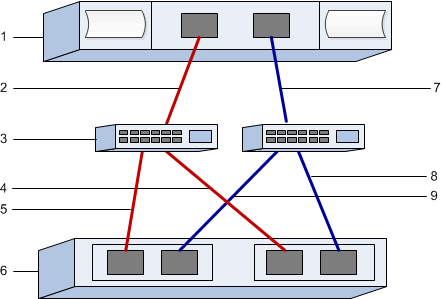

= Configure switches FC e identificadores de host para VMware no storage E-Series
:allow-uri-read: 
:icons: font
:imagesdir: ../media/

[role="lead"]
Para o protocolo Fibre Channel (FCP), você configura os switches e determina os identificadores de porta do host.

NOTE: Para garantir a compatibilidade com o VMware, os volumes devem ser configurados para utilizar emulação de 512 bytes (512e) ao usar unidades de 4096 bytes. Consulte a ajuda online do SANtricity System Manager para obter mais informações sobre como configurar um volume para usar emulação de 512 bytes (512e).

[[step-1-record-your-configuration]]
== Etapa 1: registre sua configuração

Você pode gerar e imprimir um PDF desta página e, em seguida, usar a planilha a seguir para registrar as informações de configuração de storage FC. Você precisará dessas informações ao executar tarefas de provisionamento.

A ilustração mostra um host conectado a um array de storage E-Series em duas zonas. Uma zona é indicada pelas linhas vermelhas; a outra zona é indicada pelas linhas azuis. Cada zona contém pelo menos uma porta iniciadora e metade de todas as portas de destino. O número de portas do host e/ou do controlador varia de acordo com o número de adaptadores de barramento do host e o modelo do controlador. Você pode ter mais portas disponíveis (até 12 por controlador). Imprima PDFs adicionais conforme necessário.

[[host-identifiers]]
=== Identificadores de host

|===
| Legenda n.º | Conexões de porta de host (iniciador) | WWPN 

 a| 
1
 a| 
Host
 a| 
_não aplicável_

 a| 
2
 a| 
Porta de host 0 para a zona de switch FC 0
 a| 

 a| 
7
 a| 
Porta de host 1 para a zona de switch FC 1
 a| 

|===

[[target-identifiers]]
=== Identificadores de destino

|===
| Legenda n.º | Conexões de porta do controlador de matriz (destino) | WWPN 

 a| 
3
 a| 
Interrutor
 a| 
_não aplicável_

 a| 
6
 a| 
Controlador de array (destino)
 a| 
_não aplicável_

 a| 
5
 a| 
Controlador A, porta 1 para o switch FC 1
 a| 

 a| 
5
 a| 
Controlador A, porta 2 para switch FC 1
 a| 

 a| 
9
 a| 
Controlador A, porta 3 para switch FC 2
 a| 

 a| 
9
 a| 
Controlador A, porta 4 para switch FC 2
 a| 

 a| 
4
 a| 
Controlador B, porta 1 para o switch FC 1
 a| 

 a| 
4
 a| 
Controlador B, porta 2 para switch FC 1
 a| 

 a| 
8
 a| 
Controlador B, porta 3 para switch FC 2
 a| 

 a| 
8
 a| 
Controlador B, porta 4 para switch FC 2
 a| 

|===

[[host-mapping-information]]
=== Informações de mapeamento de host

[cols="35h,~"]
|===
| Mapeando o nome do host |  

| Tipo de SO de host |  
|===

[[step-2-determine-the-host-port-wwpns]]
== Etapa 2: determine os WWPNs da porta do host

Para configurar o zoneamento FC, você deve determinar o nome da porta mundial (WWPN) de cada porta do iniciador.

.Passos
. Conecte-se ao host ESXi usando SSH ou o shell do ESXi. Para habilitar o shell do ESXi, consulte  https://knowledge.broadcom.com/external/article/311213/using-esxi-shell-in-esxi.html["Utilizando o Shell do ESXi no ESXi"^].
. Execute o seguinte comando:
+
[listing]
----
esxcli storage core adapter list
----
. Registre os identificadores WWPN do iniciador (UID no formato - fc.WWNN:WWPN). A saída será semelhante a este exemplo:
+
[listing]
----
HBA Name  Driver    Link State  UID                                   Capabilities         Description
--------  --------  ----------  ------------------------------------  -------------------  -----------
vmhba4    lpfc      link-up     fc.200070b7e4395530:100070b7e4395530  Second Level Lun ID  (0000:5e:00.0) Emulex Corporation Emulex LPe35000/LPe36000 Fibre Channel Adapter
vmhba5    lpfc      link-up     fc.200070b7e4395531:100070b7e4395531  Second Level Lun ID  (0000:5e:00.1) Emulex Corporation Emulex LPe35000/LPe36000 Fibre Channel Adapter
vmhba64   lpfc      link-up     fc.200070b7e4395530:100070b7e4395530                       (0000:5e:00.0) Emulex Corporation Emulex LPe35000/LPe36000 Fibre Channel Adapter
vmhba65   lpfc      link-up     fc.200070b7e4395531:100070b7e4395531                       (0000:5e:00.1) Emulex Corporation Emulex LPe35000/LPe36000 Fibre Channel Adapter

----

No exemplo acima, os UIDs para vmhba4 e vmhba64, assim como para vmhba5 e vmhba65, são idênticos. Isso é esperado para adaptadores FC que suportam tanto FCP quanto NVMe sobre FC. Registre cada WWPN exclusivo.

NOTE: Outra opção de comando é  `esxcli storage san fc list`. Isso exibirá mais detalhes e o WWPN em formato hexadecimal separados por dois pontos.

[[step-3-configure-the-fc-switches]]
== Etapa 3: configure os switches FC

Configurar (zonear) os switches Fibre Channel (FC) permite que os hosts se conetem ao storage array e limita o número de caminhos. Você pode definir a zona dos switches usando a interface de gerenciamento dos switches.

.Antes de começar
Certifique-se de que tem o seguinte:

* Credenciais de administrador para os switches.
* O WWPN de cada porta iniciadora do host e de cada porta de destino do controlador conectada ao switch.

NOTE: O utilitário HBA de um fornecedor pode ser usado para atualizar e obter informações específicas sobre o HBA. Consulte a seção de suporte do site do fornecedor para obter instruções sobre como obter o utilitário HBA.

.Sobre esta tarefa
Cada porta do iniciador deve estar em uma zona separada com todas as portas de destino correspondentes. Para obter detalhes sobre o zoneamento de seus switches, consulte a documentação do fornecedor do switch.

.Passos
. Faça login no programa de administração do switch FC e selecione a opção de configuração de zoneamento.
. Crie uma nova zona que inclua a primeira porta do iniciador do host e que também inclua todas as portas de destino que se conetam ao mesmo switch FC que o iniciador.
. Crie zonas adicionais para cada porta do iniciador do host FC no switch.
. Salve as zonas e, em seguida, ative a nova configuração de zoneamento.

Consulte a documentação do fornecedor do switch para obter instruções detalhadas sobre como configurar zonas.
