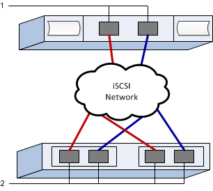

= Configure os switches iSCSI e a rede para VMware no storage E-Series
:allow-uri-read: 
:experimental: 
:icons: font
:imagesdir: ../media/

[role="lead"]
Para o protocolo iSCSI, configure os switches e configure a rede no lado da matriz e no lado do host. Em seguida, você verifica as conexões de rede IP.

NOTE: Para garantir a compatibilidade com o VMware, os volumes devem ser configurados para utilizar emulação de 512 bytes (512e) ao usar unidades de 4096 bytes. Consulte a ajuda online do SANtricity System Manager para obter mais informações sobre como configurar um volume para usar emulação de 512 bytes (512e).

[[step-1-record-your-configuration]]
== Etapa 1: registre sua configuração

Você pode gerar e imprimir um PDF desta página e, em seguida, usar a planilha a seguir para registrar suas informações de configuração de storage específicas do protocolo. Você precisará dessas informações ao executar tarefas de provisionamento.

A ilustração mostra um host conectado a um array de storage E-Series, separados por VLANs e/ou sub-redes exclusivas. Uma VLAN/sub-rede é indicada pela linha azul; a outra VLAN/sub-rede é indicada pela linha vermelha. Cada VLAN/sub-rede contém pelo menos uma porta iniciadora e metade das portas de destino. O número de portas do host e/ou do controlador varia de acordo com o número de interfaces de rede e o modelo do controlador. Você pode ter mais portas disponíveis (até 6 por controlador).

[[host-mapping-information]]
=== Informações de mapeamento de host

[cols="35h,~"]
|===
| Mapeando o nome do host |  

| Tipo de SO de host |  

| IQN do host |  

| Objetivo IQN |  
|===

[[step-2-configure-the-switches]]
== Passo 2: configure os switches

Você configura os switches de acordo com as recomendações do fornecedor para iSCSI. Essas recomendações podem incluir diretivas de configuração, bem como atualizações de código.

.Antes de começar
Certifique-se de que tem o seguinte:

* Duas redes separadas para alta disponibilidade. Certifique-se de isolar o tráfego iSCSI para segmentos de rede separados.
* Ativou o controle de fluxo de hardware *completamente* de envio e recebimento.
* Controle de fluxo de prioridade desativado.
* Se for apropriado, habilite os quadros jumbo (recomendado).

NOTE: Os canais de porta/LACP não são suportados nas portas do switch do controlador. O LACP do lado do host não é recomendado; o multipathing oferece os mesmos benefícios ou melhores.

.Passos
Consulte a documentação do fornecedor do switch.

[[step-3-configure-networking]]
== Etapa 3: configurar rede

Pode configurar a sua rede iSCSI de várias formas, dependendo dos requisitos de armazenamento de dados. Consulte o administrador da rede para obter dicas sobre como selecionar a melhor configuração para o seu ambiente.

.Antes de começar
Certifique-se de que tem o seguinte:

* Ativou o controle de fluxo de hardware *completamente* de envio e recebimento.
* Controle de fluxo de prioridade desativado.
* Se for apropriado, habilite os quadros jumbo (recomendado).
+
Se você estiver usando jumbo frames no SAN IP por motivos de desempenho, certifique-se de configurar o array, os switches e os hosts para usar jumbo frames. Consulte a documentação do seu sistema operacional e dos switches para obter informações sobre como habilitar jumbo frames nos hosts e nos switches. Para habilitar jumbo frames no array, siga os passos descritos na Etapa 4.

.Sobre esta tarefa
Ao planejar sua rede iSCSI, lembre-se de que o  https://configmax.broadcom.com/guest["Guia de máximos de configuração do VMware"^] estabelece que o número máximo de caminhos iSCSI suportados para um LUN é 32 e o número máximo de placas de interface de rede (NICs) que podem ser associadas ou vinculadas por porta à pilha de software iSCSI por servidor é 8. Você deve considerar esse requisito para evitar configurar muitos caminhos.

Por padrão, o iniciador de software iSCSI da VMware cria uma única sessão por destino iSCSI quando você não está usando a vinculação de porta iSCSI.

NOTE: A vinculação de portas iSCSI da VMware é um recurso que força todas as portas VMkernel vinculadas a se conectarem a todas as portas de destino acessíveis nos segmentos de rede configurados. Ela foi projetada para ser usada com arrays que apresentam um único endereço de rede para o destino iSCSI. NetApp recomenda que a vinculação de portas iSCSI não seja usada. Para obter mais informações, consulte  https://techdocs.broadcom.com/us/en/vmware-cis/vsphere/vsphere/9-1/vsphere-storage/configuring-iscsi-and-iser-adapters-and-storage-with-esxi/setting-up-network-for-iscsi-and-iser-with-esxi/best-practices-for-configuring-networking-with-software-iscsi.html["Melhores práticas para usar o vínculo de porta iSCSI por software no ESX/ESXi"^]. Se o host ESXi estiver conectado ao storage de outro fornecedor, NetApp recomenda que você use portas VMkernel iSCSI separadas para evitar qualquer conflito com a vinculação de portas.

Para garantir uma boa configuração de multipathing, use vários segmentos de rede para a rede iSCSI. Coloque pelo menos uma porta do lado do host e pelo menos uma porta de cada controlador de array em um segmento de rede e um grupo idêntico de portas do lado do host e do lado do array em outro segmento de rede. Sempre que possível, use vários switches Ethernet para fornecer redundância adicional.

.Passos
Consulte a documentação do fornecedor do switch.

NOTE: Muitos switches de rede precisam ser configurados acima de 9.000 bytes para sobrecarga IP. Consulte a documentação do switch para obter mais informações.

[[step-4-configure-array-side-networking]]
== Etapa 4: Configurar rede do lado do array

Você usa a GUI do Gerenciador de sistema do SANtricity para configurar a rede iSCSI no lado da matriz.

.Antes de começar
Certifique-se de que tem o seguinte:

* O endereço IP ou nome de domínio de um dos controladores de storage array.
* A senha para a GUI do System Manager, o controle de acesso baseado em função (RBAC) ou LDAP e um serviço de diretório é configurada para o acesso de segurança apropriado ao storage array. Consulte a ajuda on-line do Gerenciador de sistemas do SANtricity para obter mais informações sobre o Gerenciamento de Acesso.

.Sobre esta tarefa
Esta tarefa descreve como aceder à configuração da porta iSCSI a partir da página hardware. Também pode aceder à configuração a partir do menu:sistema[Definições > Configurar portas iSCSI].

NOTE: Para obter informações adicionais sobre como configurar a rede em sua configuração VMware, consulte o seguinte relatório técnico: https://www.netapp.com/pdf.html?item=/media/17017-tr4789.pdf["Guia de configuração da VMware para integração iSCSI SANtricity da série e com ESXi 6.x e 7.x"^].

.Passos
. No seu navegador, insira o seguinte URL: `+https://<DomainNameOrIPAddress>+`
+
`IPAddress` é o endereço de uma das controladoras de storage array.

+
Na primeira vez que o Gerenciador do sistema SANtricity é aberto em uma matriz que não foi configurada, o prompt Definir senha do administrador é exibido. O gerenciamento de acesso baseado em função configura quatro funções locais: administração, suporte, segurança e monitor. Os três últimos papéis têm senhas aleatórias que não podem ser adivinhadas. Depois de definir uma senha para a função de administrador, você pode alterar todas as senhas usando as credenciais de administrador. Consulte a ajuda on-line do Gerenciador de sistema do SANtricity para obter mais informações sobre as quatro funções de usuário locais.

. Introduza a palavra-passe do Gestor do sistema para a função de administrador nos campos Definir palavra-passe do administrador e confirmar palavra-passe e, em seguida, clique em *Definir palavra-passe*.
+
O assistente de configuração é iniciado se não houver pools, grupos de volumes, cargas de trabalho ou notificações configuradas.

. Feche o assistente de configuração.
+
Você usará o assistente mais tarde para concluir tarefas de configuração adicionais.

. Selecione *hardware*.
. Se o gráfico mostrar as unidades, clique em *Mostrar parte traseira da prateleira*.
+
O gráfico muda para mostrar os controladores em vez das unidades.

. Clique no controlador com as portas iSCSI que pretende configurar.
+
É apresentado o menu de contexto do controlador.

. Selecione *Configurar portas iSCSI*.
+
Abre-se a caixa de diálogo Configurar portas iSCSI.

. Na lista suspensa, selecione a porta que deseja configurar e clique em *Avançar*.
. Selecione as definições da porta de configuração e, em seguida, clique em *seguinte*.
+
Para ver todas as configurações de porta, clique no link *Mostrar mais configurações de porta* à direita da caixa de diálogo.

+
|===
| Definição da porta | Descrição 

 a| 
Velocidade da porta ethernet configurada
 a| 
Selecione a velocidade desejada. As opções que aparecem na lista suspensa dependem da velocidade máxima que sua rede pode suportar (por exemplo, 25 Gbps).

NOTE: As placas de interface de host iSCSI disponíveis nos controladores não negociam velocidades automaticamente. Você deve definir a velocidade de cada porta para 1 Gb, 10 Gb ou 25 Gb. Todas as portas devem ser configuradas com a mesma velocidade.

 a| 
Ativar IPv4 / ativar IPv6
 a| 
Selecione uma ou ambas as opções para ativar o suporte para redes IPv4G e IPv6G.

 a| 
Porta de escuta TCP (disponível clicando em *Mostrar mais configurações de porta*.)
 a| 
Se necessário, introduza um novo número de porta.

A porta de escuta é o número da porta TCP que o controlador usa para ouvir logins iSCSI de iniciadores iSCSI do host. A porta de escuta padrão é 3260. Tem de introduzir 3260 ou um valor entre 49152 e 65535.

 a| 
Tamanho MTU (disponível clicando em *Mostrar mais configurações de porta*.)
 a| 
Se necessário, introduza um novo tamanho em bytes para a unidade máxima de transmissão (MTU).

O tamanho padrão da Unidade Máxima de Transmissão (MTU) é de 1500 bytes por quadro. Você deve inserir um valor entre 1500 e 9000. Para habilitar quadros jumbo, defina esse valor para 9000 bytes.

 a| 
Ative as respostas ICMP PING
 a| 
Selecione esta opção para ativar o ICMP (Internet Control Message Protocol). Os sistemas operativos dos computadores em rede utilizam este protocolo para enviar mensagens. Essas mensagens ICMP determinam se um host é acessível e quanto tempo leva para obter pacotes de e para esse host.

|===
+
Se você selecionou *Ativar IPv4*, uma caixa de diálogo será aberta para selecionar IPv4 configurações depois de clicar em *Avançar*. Se você selecionou *Ativar IPv6*, uma caixa de diálogo será aberta para selecionar IPv6 configurações depois de clicar em *Avançar*. Se você selecionou ambas as opções, a caixa de diálogo para configurações IPv4 será aberta primeiro e, depois de clicar em *Avançar*, a caixa de diálogo para configurações IPv6 será aberta.

. Configure as definições IPv4 e/ou IPv6, automática ou manualmente. Para ver todas as configurações de porta, clique no link *Mostrar mais configurações* à direita da caixa de diálogo.
+
|===
| Definição da porta | Descrição 

 a| 
Obter automaticamente a configuração
 a| 
Selecione esta opção para obter a configuração automaticamente.

 a| 
Especifique manualmente a configuração estática
 a| 
Selecione esta opção e, em seguida, introduza um endereço estático nos campos. Para IPv4, inclua a máscara de sub-rede e o gateway. Para IPv6, inclua o endereço IP roteável e o endereço IP do roteador.

|===
. Clique em *Finish*.
. Feche o System Manager.

[[step-5-configure-host-side-networking]]
== Etapa 5: Configurar a rede do lado do host

A configuração de rede iSCSI no lado do host permite que o iniciador iSCSI VMware estabeleça uma sessão com o array.

.Sobre esta tarefa
Esta tarefa configura a rede iSCSI no lado do host e estabelece sessões iSCSI com o array de storage.

Depois de concluir esta tarefa, o host é configurado com um único vSwitch contendo ambas as portas VMkernel e vmnics.

Para obter informações adicionais sobre como configurar a rede iSCSI para VMware, consulte  https://techdocs.broadcom.com/us/en/vmware-cis/vsphere/vsphere/9-1/vsphere-storage/configuring-iscsi-and-iser-adapters-and-storage-with-esxi.html["Configurando adaptadores iSCSI e storage com o ESXi"^].

NOTE: Anote o Nome Qualificado iSCSI (IQN) durante este processo a partir do adaptador iSCSI de software adicionado. Isso será necessário posteriormente ao configurar os mapeamentos de host.

.Antes de começar
Certifique-se de que tem o seguinte:

* Switch(es) configurados que serão usados para transportar o tráfego de storage iSCSI.
* Envio e recebimento de controle de fluxo de hardware completamente habilitados no switch.
* Controle de fluxo prioritário desativado no switch.
* Configuração iSCSI do lado do array concluída.
* Pelo menos duas portas NIC do host para tráfego iSCSI.

.Passos
. Use o vSphere Client ou o vSphere Web Client para realizar a configuração do lado do host. Consulte  https://techdocs.broadcom.com/us/en/vmware-cis/vsphere/vsphere/9-1/vsphere-storage/configuring-iscsi-and-iser-adapters-and-storage-with-esxi.html["Configurando adaptadores iSCSI e storage com o ESXi"^].
+
As interfaces variam em funcionalidade e o fluxo de trabalho exato varia.

. Configure a rede para iSCSI. Consulte  https://techdocs.broadcom.com/us/en/vmware-cis/vsphere/vsphere/9-1/vsphere-storage/configuring-iscsi-and-iser-adapters-and-storage-with-esxi/setting-up-network-for-iscsi-and-iser-with-esxi.html["Configurando a rede para iSCSI com ESX"^].
+
.. Não é recomendável usar a vinculação de portas. A vinculação de portas iSCSI da VMware é um recurso que força todas as portas VMkernel vinculadas a se conectarem a todas as portas de destino acessíveis nos segmentos de rede configurados. Ela foi projetada para ser usada com arrays que apresentam um único endereço de rede para o destino iSCSI. NetApp recomenda que a vinculação de portas iSCSI não seja usada. Para obter mais informações, consulte  https://techdocs.broadcom.com/us/en/vmware-cis/vsphere/vsphere/9-1/vsphere-storage/configuring-iscsi-and-iser-adapters-and-storage-with-esxi/setting-up-network-for-iscsi-and-iser-with-esxi/best-practices-for-configuring-networking-with-software-iscsi.html["Melhores práticas para usar o vínculo de porta iSCSI por software no ESX/ESXi"^]. Se o host ESXi estiver conectado ao storage de outro fornecedor, NetApp recomenda que você use portas VMkernel iSCSI separadas para evitar qualquer conflito com a vinculação de portas.
.. NetApp recomenda o mapeamento de vários adaptadores em um vSphere Standard Switch, utilizando adaptadores ativos/em espera para redundância. Consulte  https://techdocs.broadcom.com/us/en/vmware-cis/vsphere/vsphere/9-1/vsphere-storage/configuring-iscsi-and-iser-adapters-and-storage-with-esxi/setting-up-network-for-iscsi-and-iser-with-esxi/multiple-network-adapters-in-iscsi-or-iser-configuration.html["Vários adaptadores de rede na configuração iSCSI"^].
.. Habilite Jumbo Frames com iSCSI, se desejar. Consulte  https://techdocs.broadcom.com/us/en/vmware-cis/vsphere/vsphere/9-1/vsphere-storage/configuring-iscsi-and-iser-adapters-and-storage-with-esxi/using-jumbo-frames-with-iscsi-and-iser.html["Utilizando Jumbo Frames com iSCSI no ESX"^].

. Adicione um adaptador iSCSI por software. Consulte  https://techdocs.broadcom.com/us/en/vmware-cis/vsphere/vsphere/9-1/vsphere-storage/configuring-iscsi-and-iser-adapters-and-storage-with-esxi/configure-the-software-iscsi-adapter-with-esxi/add-or-remove-the-software-iscsi-adapter.html["Adicionar ou remover o adaptador iSCSI de software"^].
+
.. Anote o IQN do host e adicione um alias iSCSI (opcional). Consulte  https://techdocs.broadcom.com/us/en/vmware-cis/vsphere/vsphere/9-1/vsphere-storage/configuring-iscsi-and-iser-adapters-and-storage-with-esxi/modify-general-properties-for-iscsi-and-iser-adapters-on-esxi-hosts.html["Modificar propriedades gerais do iSCSI em hosts ESX"^].
.. Configure os parâmetros CHAP, caso esteja usando segredos CHAP. Consulte  https://techdocs.broadcom.com/us/en/vmware-cis/vsphere/vsphere/9-1/vsphere-storage/configuring-iscsi-and-iser-adapters-and-storage-with-esxi/configuring-chap-parameters-for-iscsi-or-iser-storage-adapters-with-esxi.html["Configurando os parâmetros CHAP para adaptadores iSCSI em um host ESX"^].

Após a adição bem-sucedida, as conexões podem ser visualizadas na seção Adaptadores de Armazenamento no vSphere Client. Caso a adição não seja bem-sucedida, pule para a etapa 6 para verificar a comunicação com as portas e corrigir quaisquer configurações de conexão.

[[step-6-verify-ip-network-connections]]
== Etapa 6: verificar conexões de rede IP

Você verifica as conexões de rede IP (Internet Protocol) usando testes de ping para garantir que o host e o array possam se comunicar.

.Passos
. No host, execute um dos seguintes comandos, dependendo se os quadros jumbo estão ativados:
+
** Se os quadros jumbo não estiverem ativados, execute este comando:
+
[listing]
----
vmkping <iSCSI_target_IP_address\>
----
** Se os quadros jumbo estiverem ativados, execute o comando ping com um tamanho de carga útil de 8.972 bytes. Os cabeçalhos combinados IP e ICMP são 28 bytes, que quando adicionados à carga útil, equivale a 9.000 bytes. O interrutor -s define o `packet size` bit. O switch -d define o bit DF (não fragmentar) no pacote IPv4. Essas opções permitem que quadros jumbo de 9.000 bytes sejam transmitidos com sucesso entre o iniciador iSCSI e o destino.
+
[listing]
----
vmkping -s 8972 -d <iSCSI_target_IP_address\>
----
+
Neste exemplo, o endereço IP de destino iSCSI é `192.0.2.8`.

+
[listing]
----
vmkping -s 8972 -d 192.0.2.8
Pinging 192.0.2.8 with 8972 bytes of data:
Reply from 192.0.2.8: bytes=8972 time=2ms TTL=64
Reply from 192.0.2.8: bytes=8972 time=2ms TTL=64
Reply from 192.0.2.8: bytes=8972 time=2ms TTL=64
Reply from 192.0.2.8: bytes=8972 time=2ms TTL=64
Ping statistics for 192.0.2.8:
  Packets: Sent = 4, Received = 4, Lost = 0 (0% loss),
Approximate round trip times in milliseconds:
  Minimum = 2ms, Maximum = 2ms, Average = 2ms
----

. Emita um `vmkping` comando do endereço do iniciador de cada host (o endereço IP da porta Ethernet do host usada para iSCSI) para cada porta iSCSI do controlador. Execute esta ação a partir de cada servidor host na configuração, alterando os endereços IP conforme necessário.
+

NOTE: Se o comando falhar com a mensagem `sendto() failed (Message too long)`, verifique o tamanho da MTU (suporte a quadros jumbo) para as interfaces Ethernet no servidor host, no controlador de armazenamento e nas portas do switch.

. Se a descoberta na etapa 5 não for bem-sucedida, retorne ao procedimento de configuração de rede do lado do host iSCSI para concluir a descoberta da sessão.

