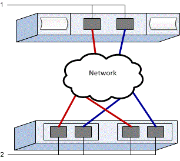

= Configure switches NVMe sobre RoCE para VMware no storage E-Series
:allow-uri-read: 
:icons: font
:imagesdir: ../media/

[role="lead"]
Para o protocolo NVMe sobre RoCE, você configura os switches e determina o Nome Qualificado NVMe (NQN) do host.

NOTE: Para garantir a compatibilidade com o VMware, os volumes devem ser configurados para utilizar emulação de 512 bytes (512e) ao usar unidades de 4096 bytes. Consulte a ajuda online do SANtricity System Manager para obter mais informações sobre como configurar um volume para usar emulação de 512 bytes (512e).

[[step-1-record-your-configuration]]
== Etapa 1: registre sua configuração

Você pode gerar e imprimir um PDF desta página e, em seguida, usar a planilha a seguir para registrar suas informações de configuração de storage específicas do protocolo. Você precisará dessas informações ao executar tarefas de provisionamento.

A ilustração mostra um host conectado a um array de storage E-Series, separados por VLANs e/ou sub-redes exclusivas. Uma VLAN/sub-rede é indicada pela linha azul; a outra VLAN/sub-rede é indicada pela linha vermelha. Cada VLAN/sub-rede contém pelo menos uma porta iniciadora e metade das portas de destino. O número de portas do host e/ou do controlador varia de acordo com o número de interfaces de rede e o modelo do controlador. Você pode ter mais portas disponíveis (até 6 por controlador).

[[host-mapping-information]]
=== Informações de mapeamento de host

[cols="35h,~"]
|===
| Mapeando o nome do host |  

| Tipo de SO de host |  

| NQN do host |  

| NQN alvo |  
|===

[[step-2-configure-the-nvmeroce-switches]]
== Etapa 2: configurar os switches NVMe/RoCE

Você configura os switches de acordo com as recomendações do fornecedor para NVMe em RoCE. Essas recomendações podem incluir diretivas de configuração, bem como atualizações de código.

.Sobre esta tarefa
Esta tarefa descreve os passos gerais para configurar os switches para NVMe sobre RoCE. Para instruções específicas, consulte a documentação do fornecedor do switch.

.Antes de começar
Certifique-se de que tem o seguinte:

* Duas redes separadas para alta disponibilidade. Certifique-se de isolar o seu tráfego NVMe sobre RoCE em segmentos de rede separados.

.Passos
Consulte a documentação do fornecedor do switch.

[[step-3-configure-networking]]
== Etapa 3: configurar rede

Você pode configurar sua rede NVMe sobre RoCE de diversas maneiras, dependendo dos seus requisitos de storage. Consulte o administrador de rede para dicas sobre como selecionar a melhor configuração para o seu ambiente.

.Sobre esta tarefa
Esta tarefa descreve os passos gerais para configurar a rede para NVMe sobre RoCE. Para instruções específicas, consulte a documentação do fornecedor do seu switch.

.Antes de começar
Certifique-se de que tem o seguinte:

* Switch configurado para Ethernet sem perda para NVMe sobre RDMA (se o switch estiver no caminho).

Ao planejar sua rede NVMe over RoCE, lembre-se de que o  https://configmax.broadcom.com/guest["Guia de máximos de configuração do VMware"^] estabelece que o número máximo de portas iniciadoras RDMA NVMe suportadas por servidor é 2. Você deve considerar esse requisito para evitar configurar muitos caminhos.

Para garantir uma boa configuração de multipathing, utilize vários segmentos de rede para a rede NVMe sobre RoCE. Coloque pelo menos uma porta do lado do host e pelo menos uma porta de cada controlador de array em um segmento de rede, e um grupo idêntico de portas do lado do host e do lado do array em outro segmento de rede. Sempre que possível, utilize vários switches Ethernet para fornecer redundância.

.Passos
Consulte a documentação do fornecedor do switch.

[[step-4-configure-array-side-networking]]
== Etapa 4: Configurar rede do lado do array

Você utiliza a interface SANtricity System Manager para configurar NVMe over RoCE na rede do lado do array.

.Sobre esta tarefa
Esta tarefa descreve como acessar a configuração da porta NVMe sobre RoCE na página *Controladores e componentes* do SANtricity System Manager. Você também pode acessar a configuração na página *Configurar portas NVMe sobre RoCE* dentro do SANtricity System Manager.

.Antes de começar
Certifique-se de que tem o seguinte:

* O endereço IP ou nome de domínio de um dos controladores de storage array.
* Senha para a System Manager GUI, ou Role-Based Access Control (RBAC) ou LDAP e um serviço de diretório está configurado para o acesso de segurança apropriado ao array de storage. Consulte a ajuda online do SANtricity System Manager para obter mais informações sobre link:https://docs.netapp.com/us-en/e-series-santricity/um-certificates/overview-access-management-um.html["Gerenciamento de acesso"^].

.Passos
. No seu navegador, digite o seguinte URL: https://<DomainNameOrIPAddress>[]
+
`IPAddress` é o endereço de uma das controladoras de storage array.

+
Na primeira vez que o Gerenciador do sistema SANtricity é aberto em uma matriz que não foi configurada, o prompt Definir senha do administrador é exibido. O gerenciamento de acesso baseado em função configura quatro funções locais: administração, suporte, segurança e monitor. Os três últimos papéis têm senhas aleatórias que não podem ser adivinhadas. Depois de definir uma senha para a função de administrador, você pode alterar todas as senhas usando as credenciais de administrador. Consulte a ajuda on-line do Gerenciador de sistema do SANtricity para obter mais informações sobre as quatro funções de usuário locais.

. Introduza a palavra-passe do Gestor do sistema para a função de administrador nos campos Definir palavra-passe do administrador e confirmar palavra-passe e, em seguida, clique em *Definir palavra-passe*.
+
O assistente de configuração é iniciado se não houver pools, grupos de volumes, cargas de trabalho ou notificações configuradas.

. Feche o assistente de configuração.
+
Você usará o assistente mais tarde para concluir tarefas de configuração adicionais.

. Selecione *Hardware* > *Controladores e componentes*.
. Clique no controlador com as portas NVMe sobre RoCE que você deseja configurar.
+
É apresentado o menu de contexto do controlador.

. Selecione *Configure NVMe over RoCE ports*.
+
A caixa de diálogo Configurar NVMe sobre portas RoCE é aberta.

. Na lista suspensa, selecione a porta que deseja configurar e clique em *Avançar*.
. Selecione as definições da porta de configuração e, em seguida, clique em *seguinte*.
+
Para ver todas as configurações de porta, clique no link *Mostrar mais configurações de porta* à direita da caixa de diálogo.

+
|===
| Definição da porta | Descrição 

 a| 
Velocidade da porta ethernet configurada
 a| 
Selecione a velocidade desejada. As opções que aparecem na lista suspensa dependem da velocidade máxima que sua rede pode suportar (por exemplo, 200 Gb/s).

 a| 
Ativar IPv4 / ativar IPv6
 a| 
Selecione uma ou ambas as opções para ativar o suporte para redes IPv4G e IPv6G.

 a| 
Tamanho do MTU (Disponível ao clicar em Show more port settings.)
 a| 
Se necessário, introduza um novo tamanho em bytes para a unidade máxima de transmissão (MTU).

O tamanho padrão da Unidade Máxima de Transmissão (MTU) é de 4200 bytes por quadro. Você deve inserir um valor entre 1500 e 9000.

|===
+
Se você selecionou *Ativar IPv4*, uma caixa de diálogo será aberta para selecionar IPv4 configurações depois de clicar em *Avançar*. Se você selecionou *Ativar IPv6*, uma caixa de diálogo será aberta para selecionar IPv6 configurações depois de clicar em *Avançar*. Se você selecionou ambas as opções, a caixa de diálogo para configurações IPv4 será aberta primeiro e, depois de clicar em *Avançar*, a caixa de diálogo para configurações IPv6 será aberta.

+
Configure as definições IPv4 e/ou IPv6, automática ou manualmente. Para ver todas as configurações de porta, clique no link *Mostrar mais configurações* à direita da caixa de diálogo.

+
|===
| Definição da porta | Descrição 

 a| 
Obter automaticamente a configuração
 a| 
Selecione esta opção para obter a configuração automaticamente.

 a| 
Especifique manualmente a configuração estática
 a| 
Selecione esta opção e, em seguida, introduza um endereço estático nos campos. Para IPv4, inclua a máscara de sub-rede e o gateway. Para IPv6, inclua o endereço IP roteável e o endereço IP do roteador.

|===
. Clique em *Finish*.
. Feche o System Manager.

[[step-5-configure-host-side-networking]]
== Etapa 5: Configurar a rede do lado do host

Configurar NVMe over RoCE na rede do lado do host permite que o iniciador do adaptador de storage VMware NVMe over RDMA estabeleça uma sessão com o array.

.Antes de começar
Se o host se conectar ao array de storage por meio de switches Ethernet, a rede Ethernet sem perda deve ser configurada nos switches, conforme descrito nas Etapas 2 e 3. Nesse caso, a configuração de rede sem perda baseada em switch terá prioridade e você não precisará concluir o pré-requisito do lado do host descrito abaixo.

Se o host tiver uma conexão direta com o array de storage (sem switch no caminho), conclua o seguinte pré-requisito antes de configurar os adaptadores NVMe sobre RDMA do lado do host.

.Pré-requisito: configurar Ethernet sem perda para NVMe sobre RDMA (somente conexões diretas)
Você configura Ethernet sem perda usando o Controle de Fluxo Prioritário (PFC) baseado em Differentiated Services Code Point (DSCP).

Para obter mais informações, consulte link:https://techdocs.broadcom.com/us/en/vmware-cis/vsphere/vsphere/9-1/vsphere-storage/about-vmware-nvme-storage/requirements-for-vmware-nvme-storage.html#GUID-B764140D-BCF3-4C99-8169-E5B058757518-en["Configurando Ethernet sem perda para NVMe sobre RDMA"^].

.Sobre esta tarefa
Esta tarefa cria os adaptadores de host NVMe sobre RDMA e adiciona conexões de controlador ao storage.

.Passos
. Identifique os adaptadores de rede RDMA e registre o uplink emparelhado da vmnic.
+
Para obter mais informações, consulte link:https://techdocs.broadcom.com/us/en/vmware-cis/vsphere/vsphere/9-1/vsphere-storage/about-vmware-nvme-storage/configuring-nvme-over-rdma-roce-v2-on-esxi/view-rdma-network-adapters.html["Visualizar adaptadores de rede RDMA"^].

. Configurar a vinculação de porta VMkernel para o adaptador RDMA usando um vSphere standard switch.
+
Para obter mais informações, consulte link:https://techdocs.broadcom.com/us/en/vmware-cis/vsphere/vsphere/9-1/vsphere-storage/about-vmware-nvme-storage/configuring-nvme-over-rdma-roce-v2-on-esxi/configure-vmkernel-binding-for-the-rdma-adapter/configure-vmkernel-binding-with-a-vsphere-standard-switch.html["Configurar a vinculação do VMkernel para o adaptador RDMA"^].

. Adicione o adaptador de software NVMe over RDMA.
+
Para obter mais informações, consulte link:https://techdocs.broadcom.com/us/en/vmware-cis/vsphere/vsphere/9-1/vsphere-storage/about-vmware-nvme-storage/configuring-nvme-over-rdma-roce-v2-on-esxi/add-software-nvme-over-rdma-or-nvme-over-tcp-adapters.html["Adicionar adaptadores de software NVMe sobre RDMA ou NVMe sobre TCP"^].

. Adicionar controladores NVMe para NVMe sobre RDMA.
+
Para obter mais informações, consulte link:https://techdocs.broadcom.com/us/en/vmware-cis/vsphere/vsphere/9-1/vsphere-storage/about-vmware-nvme-storage/configuring-nvme-over-rdma-roce-v2-on-esxi/add-controller-for-nvme-over-fabrics.html["Adicionar controladores para NVMe over Fabrics"^].

NOTE: O NQN do host pode ser obtido durante esse processo na caixa de diálogo Adicionar Controlador. Isso será necessário posteriormente ao configurar os mapeamentos de host.

Após a adição bem-sucedida, as conexões podem ser visualizadas na seção Adaptadores de Armazenamento no vSphere Client. Caso a adição não seja bem-sucedida, pule para a etapa 6 para verificar a comunicação com as portas e corrigir quaisquer configurações de conexão.

[[step-6-verify-ip-network-connections]]
== Etapa 6: verificar conexões de rede IP

Você verifica as conexões de rede IP (Internet Protocol) usando testes de ping para garantir que o host e o array possam se comunicar.

.Passos
. No host, execute o seguinte comando:
+
[listing]
----
vmkping <NVMe over RoCE_target_IP_address\>
----
+
Neste exemplo, o endereço IP de destino NVMe over RoCE é 192.6.21.231.

+
[listing]
----
vmkping -d 192.6.21.231
PING 192.6.21.231 (192.6.21.231): 56 data bytes
64 bytes from 192.6.21.231: icmp_seq=0 ttl=64 time=0.902 ms
64 bytes from 192.6.21.231: icmp_seq=1 ttl=64 time=0.406 ms
64 bytes from 192.6.21.231: icmp_seq=2 ttl=64 time=0.855 ms
--- 192.6.21.231 ping statistics ---
3 packets transmitted, 3 packets received, 0% packet loss
round-trip min/avg/max = 0.406/0.721/0.902 ms
----
. Emita um comando  `vmkping` a partir do endereço iniciador de cada host (o endereço IP da porta Ethernet do host usada para NVMe sobre RoCE) para cada porta NVMe sobre RoCE do controlador. Execute esta ação a partir de cada servidor host na configuração, alterando os endereços IP conforme necessário.
+

NOTE: Se o comando falhar com a mensagem  `sendto() failed (Message too long)`, verifique o tamanho do MTU para as interfaces Ethernet no servidor host, no controlador de storage e nas portas do switch.

. Caso a descoberta na etapa 5 não tenha sido bem-sucedida, retorne ao procedimento de configuração de rede NVMe sobre RoCE no host para concluir a adição dos controladores de destino.

