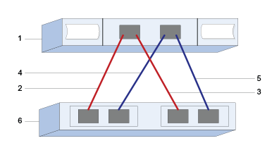

= Configure as portas e configurações do host SAS para VMware no storage E-Series
:allow-uri-read: 
:icons: font
:imagesdir: ../media/

[role="lead"]
Para o protocolo SAS, você determina os endereços da porta do host e faz as configurações recomendadas.

[[step-1-record-your-configuration]]
== Etapa 1: registre sua configuração

Você pode gerar e imprimir um PDF desta página e, em seguida, usar a planilha a seguir para registrar suas informações de configuração de storage específicas do protocolo. Você precisará dessas informações ao executar tarefas de provisionamento.

A ilustração mostra um host conectado diretamente a um array de storage E-Series com conexões redundantes (considerando um HBA SAS de 4 portas). A primeira conexão redundante é indicada pelas linhas vermelhas; a segunda conexão redundante é indicada pelas linhas azuis. O número de portas depende do número de portas do host. Você pode ter apenas 2 portas de host. Nesse caso, recomenda-se pelo menos a primeira conexão redundante.

[[host-identifiers]]
=== Identificadores de host

|===
| Legenda n.º | Conexões de porta de host (iniciador) | Endereço SAS 

 a| 
1
 a| 
Host
 a| 
_não aplicável_

 a| 
2
 a| 
Porta 1 do host (iniciador) conetada ao controlador A, porta 1
 a| 

 a| 
3
 a| 
Porta 2 do host (iniciador) conetada ao controlador B, porta 1
 a| 

 a| 
4
 a| 
A porta 3 do host (iniciador) conectada ao controlador A, porta 1
 a| 

 a| 
5
 a| 
A porta 4 do host (iniciador) conectada ao controlador B, porta 1
 a| 

|===

[[host-mapping-information]]
=== Informações de mapeamento de host

[cols="35h,~"]
|===
| Mapeando o nome do host |  

| Tipo de SO de host |  
|===

[[step-2-determine-sas-host-identifiers]]
== Etapa 2: determinar os identificadores de host SAS

Encontre os endereços SAS usando o esxcli ou o utilitário HBA.

.Sobre esta tarefa
Reveja as diretrizes para utilitários HBA:

* A maioria dos fornecedores de HBA oferece um utilitário HBA.

.Passos
. Conecte-se ao host ESXi usando SSH ou o shell do ESXi. Para habilitar o shell do ESXi, consulte  https://knowledge.broadcom.com/external/article/311213/using-esxi-shell-in-esxi.html["Utilizando o Shell do ESXi no ESXi"^].
. Execute o seguinte comando:
+
[listing]
----
esxcli storage core adapter list
----
. Registre o identificador de endereço SAS do iniciador (UID no formato - sas.<SAS_Address>). A saída será semelhante a este exemplo:
+
[listing]
----
HBA Name  Driver       Link State  UID                   Capabilities         Description
--------  ----------   ----------  --------------------  -------------------  -----------
vmhba1    lsi_msgpt35  link-n/a    sas.5b083fe0ca0e7000                       (0000:03:00.0) Avago (LSI Logic) SAS3008 12Gbps SAS HBA external
----

No exemplo acima, o UID mostrará apenas o endereço SAS base. Para as outras portas, os primeiros 14 caracteres permanecem constantes e apenas os dois últimos caracteres variam para representar portas diferentes. Normalmente, o último dígito simplesmente aumenta em 1 para cada porta. Ter o endereço SAS base geralmente é suficiente para identificar o adaptador de host durante o mapeamento de host, pois o array de storage E-Series detectará e listará automaticamente os endereços SAS das outras portas para seleção. Usar um utilitário HBA do fornecedor pode ajudar a obter o endereço SAS para cada porta.

NOTE: Outra opção de comando é  `esxcli storage san sas list`. Isso exibirá mais detalhes e o endereço SAS base em formato hexadecimal, separados por dois pontos.
