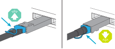
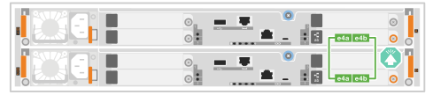
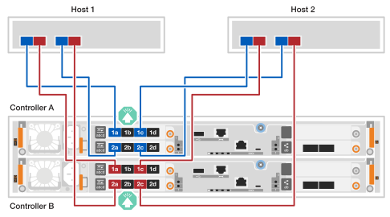
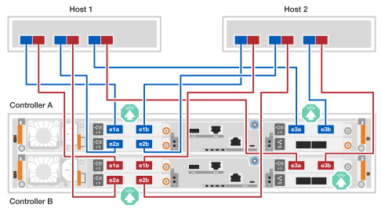
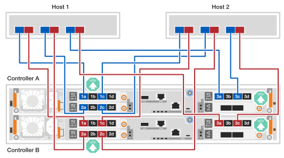
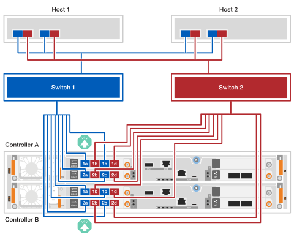
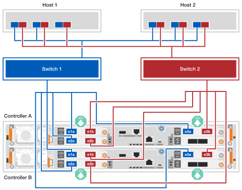
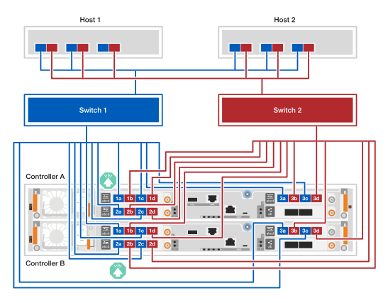
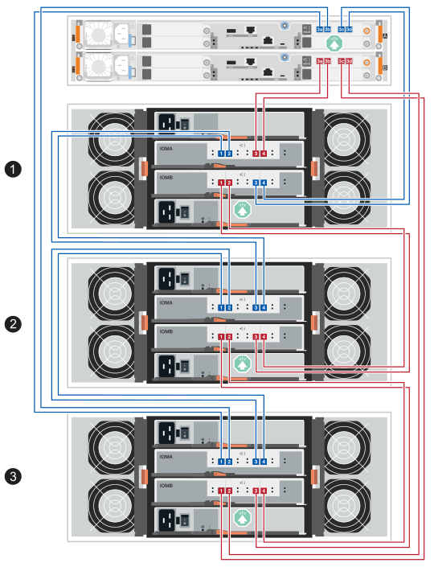

= Conecte o hardware para os sistemas de storage EF50 e EF80
:allow-uri-read: 
:icons: font
:imagesdir: ../media/

[role="lead"]
Após instalar o hardware do seu sistema de storage EF50 ou EF80, conecte o espelhamento entre controladoras, as conexões de rede do host e os gabinetes SAS, se aplicável. (Você conectará as portas de gerenciamento posteriormente na seção de configuração completa do sistema de storage.)

.Sobre esta tarefa
* O termo _módulo de E/S_ é usado para se referir às placas de interface do host (HICs) neste procedimento.
* Os diagramas de cabeamento possuem ícones de seta que indicam a orientação correta (para cima ou para baixo) da aba de puxar do conector do cabo ao inserir um conector em uma porta.
+
Ao inserir o conector, você deve sentir um clique ao encaixá-lo no lugar; se não sentir o clique, remova-o, vire-o e tente novamente.

+

[[step-1-cable-the-inter-controller-mirroring-connections]]
== Passo 1: Conecte os cabos de espelhamento entre os controladores

Conecte os controladores entre si por meio de cabos para habilitar o espelhamento entre controladores. As conexões de espelhamento entre controladores garantem total redundância do sistema e são usadas para espelhamento de cache e envio de E/S. O cabeamento é o mesmo para os sistemas de storage EF50 e EF80.

NOTE: Independentemente da velocidade dos módulos de E/S de espelhamento entre controladores instalados no seu sistema de storage (100 GbE ou 200 GbE, conforme suportado pelo seu sistema de storage), utilize os cabos de 200 GbE incluídos. Se a velocidade dos módulos de E/S de espelhamento entre controladores for de 100 GbE, a conexão operará na velocidade inferior (100 GbE).

.Passos
. Conecte os controladores entre si:
+
.. Conecte o cabo da porta e4a do controlador A à porta e4a do controlador B.
.. Conecte o cabo da porta e4b do controlador A à porta e4b do controlador B.
+
*Cabos Ethernet de 200 GbE*

+

+

[[step-2-cable-the-host-connections]]
== Passo 2: Conecte os cabos do host

Conecte os cabos do host para o seu sistema de storage de acordo com sua topologia de rede: conexão direta ou conexão por malha.

.Sobre esta tarefa
* Dependendo do modelo do seu sistema de storage e da versão do SANtricity em execução, diferentes tipos de módulos de E/S de host são suportados. Os exemplos de cabeamento neste procedimento mostram módulos de E/S de host Ethernet e Fibre Channel (FC).
+
Para ver todos os módulos de E/S do host e as prioridades de slot suportados para o modelo do seu sistema de storage, consulte link:https://hwu.netapp.com["NetApp Hardware Universe"^].

* Os exemplos de cabeamento não mostram HBAs FC de 64 Gb de 4 portas nos hosts 1 e 2; no entanto, se você os tiver instalados, conecte todas as outras portas da mesma maneira que é mostrado para os HBAs de 2 portas.

[role="tabbed-block"]
====
.Topologia de conexão direta
--
Os exemplos a seguir mostram a conexão de um sistema de storage aos hosts usando uma topologia de conexão direta.

.EF50 com dois módulos de I/O FC de 4 portas 64Gb
[%collapsible]
=====
.Sobre esta tarefa
* O exemplo de cabeamento mostra os módulos de E/S do host nos slots 1 e 2. Este é o número máximo de módulos de E/S do host suportados pelo sistema de storage EF50. No entanto, apenas o módulo de E/S do host no slot 1 é obrigatório; o módulo de E/S do host no slot 2 é opcional.
+
Se o seu sistema de storage tiver um módulo de E/S de host instalado, você pode ignorar a fiação para o módulo de E/S de host adicional e conectar os cabos apenas ao módulo de E/S de host instalado.

* Um sistema de storage conectado diretamente possui dois caminhos separados para redundância: caminho A e caminho B.
+
** A conectividade do Caminho A é mostrada com cabos azuis e portas azuis nos hosts e controladores. Ela conecta as portas HBA em cada host às portas a e c do controlador A.
** A conectividade do Path B é mostrada com cabos vermelhos e portas vermelhas nos hosts e controladores. Ela conecta as portas HBA em cada host às portas a e c do controller B.

* Embora o exemplo de cabeamento mostre as portas a e c do módulo de E/S conectadas aos hosts, você pode usar as portas a e b ou as portas c e d.

.Passos
. Conecte os hosts aos controladores:
+
.. Cabo host 1 caminho A (azul) portas HBA para as portas a do controlador A (1a e 2a).
.. Cabo host 1 caminho B (vermelho) portas HBA para as portas a do controlador B (1a e 2a).
.. Cabo host 2 caminho A (azul) portas HBA para as portas c do controlador A (1c e 2c).
.. Cabo host 2 caminho B (vermelho) portas HBA para as portas c do controlador B (1c e 2c).
+
*Cabos FC de 64 Gb/s*

+

+

=====
.EF80 com três módulos de I/O de 2 portas 200 GbE
[%collapsible]
=====
.Sobre esta tarefa
* O exemplo de cabeamento mostra os módulos de E/S do host nos slots 1, 2 e 3. Este é o número máximo de módulos de E/S do host suportados para o sistema de storage EF80. No entanto, apenas o módulo de E/S do host no slot 1 é obrigatório; os módulos de E/S do host nos slots 2 e 3 são opcionais.
+
Se o seu sistema de storage tiver menos módulos de E/S de host instalados, você pode ignorar a fiação para os módulos de E/S de host adicionais e conectar os cabos apenas aos módulos de E/S de host instalados.

* Um sistema de storage conectado diretamente possui dois caminhos separados para redundância: caminho A e caminho B.
+
** A conectividade do Caminho A é mostrada com cabos azuis e portas azuis nos hosts e controladores. Ela conecta as portas HBA em cada host às portas a e b do controlador A.
** A conectividade do Caminho B é mostrada com cabos vermelhos e portas vermelhas nos hosts e controladores. Ela conecta as portas HBA em cada host às portas a e b do controlador B.

.Passos
. Conecte os hosts aos controladores:
+
.. Cabo host 1 caminho A (azul) portas HBA para as portas a do controlador A (e1a, e2a e e3a).
.. Cabo host 1 caminho B (vermelho) portas HBA para as portas a do controlador B (e1a, e2a e e3a).
.. Cabo host 2 caminho A (azul) portas HBA para as portas b do controlador A (e1b, e2b e e3b).
.. Conecte o cabo host 2 caminho B (vermelho) portas HBA às portas b do controlador B (e1b, e2b e e3b).
+
*Cabos de 200 GbE*

+

+

=====
.EF80 com três módulos de I/O FC de 64Gb e 4 portas
[%collapsible]
=====
.Sobre esta tarefa
* O exemplo de cabeamento mostra os módulos de E/S do host nos slots 1, 2 e 3. Este é o número máximo de módulos de E/S do host suportados para o sistema de storage EF80. No entanto, apenas o módulo de E/S do host no slot 1 é obrigatório; os módulos de E/S do host nos slots 2 e 3 são opcionais.
+
Se o seu sistema de storage tiver menos módulos de E/S de host instalados, você pode ignorar a fiação para os módulos de E/S de host adicionais e conectar os cabos apenas aos módulos de E/S de host instalados.

* Um sistema de storage conectado diretamente possui dois caminhos separados para redundância: caminho A e caminho B.
+
** A conectividade do Caminho A é mostrada com cabos azuis e portas azuis nos hosts e controladores. Ela conecta as portas HBA em cada host às portas a e c do controlador A.
** A conectividade do Path B é mostrada com cabos vermelhos e portas vermelhas nos hosts e controladores. Ela conecta as portas HBA em cada host às portas a e c do controller B.

* Embora o exemplo de cabeamento mostre as portas a e c do módulo de E/S conectadas aos hosts, você pode usar as portas a e b ou as portas c e d.

.Passos
. Conecte os hosts aos controladores:
+
.. Cabo host 1 caminho A (azul) portas HBA para as portas a do controlador A (1a, 2a e 3a).
.. Cabo host 1 caminho B (vermelho) portas HBA para as portas a do controlador B (1a, 2a e 3a).
.. Cabo host 2 caminho A (azul) portas HBA para as portas c do controlador A (1c, 2c e 3c).
.. Conecte o cabo host 2 caminho B (vermelho) portas HBA às portas c do controlador B (1c, 2c e 3c).
+
*Cabos FC de 64 Gb/s*

+

+

=====
--
.Topologia conectada à estrutura
--
Os exemplos a seguir mostram a conexão de um sistema de storage aos hosts usando uma topologia fabric-attached.

.EF50 com dois módulos de I/O FC de 4 portas 64Gb
[%collapsible]
=====
.Sobre esta tarefa
* O exemplo de cabeamento mostra os módulos de E/S do host nos slots 1 e 2. Este é o número máximo de módulos de E/S do host suportados pelo sistema de storage EF50. No entanto, apenas o módulo de E/S do host no slot 1 é obrigatório; o módulo de E/S do host no slot 2 é opcional.
+
Se o seu sistema de storage tiver um módulo de E/S de host instalado, você pode ignorar a fiação para o módulo de E/S de host adicional e conectar os cabos apenas ao módulo de E/S de host instalado.

* Um sistema de storage conectado à fabric possui dois caminhos de switch separados para redundância: switch 1 path e switch 2 path.
+
** A conectividade do caminho do switch 1 é mostrada com cabos azuis e portas azuis nos hosts e controladores. Ela conecta as portas HBA em cada host através do switch 1 às portas a e c do controlador A e do controlador B.
** A conectividade do caminho do switch 2 é mostrada com cabos vermelhos e portas vermelhas nos hosts e controladores. Ela conecta as portas HBA em cada host através do switch 2 às portas b e d do controlador A e do controlador B.

.Passos
. Conecte os hosts aos switches.
+
Você pode usar qualquer porta nos switches.

+
.. Cabo host 1 e host 2 switch 1 path (azul) portas HBA para o switch 1.
.. Cabo host 1 e host 2 switch 2 caminho (vermelho) portas HBA para o switch 2.

. Conecte os switches aos controladores:
+
.. Conecte o cabo do switch 1 (azul) às portas a e c do controlador A (1a, 2a, 1c e 2c).
.. Conecte o cabo do switch 1 (azul) às portas a e c do controlador B (1a, 2a, 1c e 2c).
.. Conecte o cabo do switch 2 (vermelho) às portas b e d do controlador A (1b, 2b, 1d e 2d).
.. Conecte o cabo switch 2 (vermelho) às portas b e d do controlador B (1b, 2b, 1d e 2d).
+
*Cabos FC de 64 Gb/s*

+

+

=====
.EF80 com três módulos de I/O de 2 portas 200 GbE
[%collapsible]
=====
.Sobre esta tarefa
* O exemplo de cabeamento mostra os módulos de E/S do host nos slots 1, 2 e 3. Este é o número máximo de módulos de E/S do host suportados para o sistema de storage EF80. No entanto, apenas o módulo de E/S do host no slot 1 é obrigatório; os módulos de E/S do host nos slots 2 e 3 são opcionais.
+
Se o seu sistema de storage tiver menos módulos de E/S de host instalados, você pode ignorar a fiação para os módulos de E/S de host adicionais e conectar os cabos apenas aos módulos de E/S de host instalados.

* O exemplo de cabeamento mostra três HBAs em cada host. Se seus hosts tiverem menos de três HBAs, você pode ignorar o cabeamento para as HBAs adicionais e conectar apenas às HBAs instaladas.
* Um sistema de storage conectado à fabric possui dois caminhos de switch separados para redundância: switch 1 path e switch 2 path.
+
** A conectividade do caminho do switch 1 é mostrada com cabos azuis e portas azuis nos hosts e controladores. Ela conecta as portas HBA em cada host através do switch 1 às portas a do controlador A e do controlador B.
** A conectividade do caminho do switch 2 é mostrada com cabos vermelhos e portas vermelhas nos hosts e controladores. Ela conecta as portas HBA em cada host através do switch 2 às portas b do controlador A e do controlador B.

.Passos
. Conecte os hosts aos switches:
+
Você pode usar qualquer porta nos switches.

+
.. Cabo host 1 e host 2 switch 1 path (azul) portas HBA para o switch 1.
.. Cabo host 1 e host 2 switch 2 caminho (vermelho) portas HBA para o switch 2.

. Conecte os switches aos controladores:
+
.. Conecte o cabo do switch 1 (azul) às portas a do controlador A (e1a, e2a e e3a).
.. Conecte o cabo do switch 1 (azul) às portas a do controlador B (e1a, e2a e e3a).
.. Conecte o cabo do switch 2 (vermelho) às portas b do controlador A (e1b, e2b e e3b).
.. Conecte o cabo do switch 2 (vermelho) às portas b do controlador B (e1b, e2b e e3b).
+
*Cabos de 200 GbE*

+

+

=====
.EF80 com três módulos de I/O FC de 64Gb e 4 portas
[%collapsible]
=====
.Sobre esta tarefa
* O exemplo de cabeamento mostra os módulos de E/S do host nos slots 1, 2 e 3. Este é o número máximo de módulos de E/S do host suportados para o sistema de storage EF80. No entanto, apenas o módulo de E/S do host no slot 1 é obrigatório; os módulos de E/S do host nos slots 2 e 3 são opcionais.
+
Se o seu sistema de storage tiver menos módulos de E/S de host instalados, você pode ignorar a fiação para os módulos de E/S de host adicionais e conectar os cabos apenas aos módulos de E/S de host instalados.

* O exemplo de cabeamento mostra três HBAs em cada host. Se seus hosts tiverem menos de três HBAs, você pode ignorar o cabeamento para as HBAs adicionais e conectar apenas às HBAs instaladas.
* Um sistema de storage conectado à fabric possui dois caminhos de switch separados para redundância: switch 1 path e switch 2 path.
+
** A conectividade do caminho do switch 1 é mostrada com cabos azuis e portas azuis nos hosts e controladores. Ela conecta as portas HBA em cada host através do switch 1 às portas a e c do controlador A e do controlador B.
** A conectividade do caminho do switch 2 é mostrada com cabos vermelhos e portas vermelhas nos hosts e controladores. Ela conecta as portas HBA em cada host através do switch 2 às portas b e d do controlador A e do controlador B.

.Passos
. Conecte os hosts aos switches:
+
Você pode usar qualquer porta nos switches.

+
.. Cabo host 1 e host 2 switch 1 path (azul) portas HBA para o switch 1.
.. Cabo host 1 e host 2 switch 2 caminho (vermelho) portas HBA para o switch 2.

. Conecte os switches aos controladores:
+
.. Conecte o cabo switch 1 (azul) às portas a e c do controlador A (1a, 2a, 3a, 1c, 2c e 3c).
.. Conecte o cabo switch 1 (azul) às portas a e c do controlador B (1a, 2a, 3a, 1c, 2c e 3c).
.. Conecte o cabo do switch 2 (vermelho) às portas b e d do controlador A (1b, 2b, 3b, 1d, 2d e 3d).
.. Conecte o cabo de switch 2 (vermelho) às portas b e d do controlador B (1b, 2b, 3b, 1d, 2d e 3d).
+
*Cabos FC de 64 Gb/s*

+

+

=====
--
====

[[step-3-cable-the-sas-shelf-connections]]
== Etapa 3: Conecte os cabos SAS das prateleiras SAS

Os procedimentos a seguir mostram como conectar os controladores a uma shelf DE460C ou a uma pilha de três shelves DE460C.

.Sobre esta tarefa
* Os exemplos de cabeamento mostram os shelves DE460C; no entanto, o mesmo cabeamento se aplica a todos os shelves SAS suportados. Consulte link:https://hwu.netapp.com["NetApp Hardware Universe"^] para os shelves SAS suportados.
* Para saber o número máximo de prateleiras suportadas pelo seu sistema de storage e todas as suas opções de cabeamento, como óptico, consulte link:https://hwu.netapp.com["NetApp Hardware Universe"^].
* Os procedimentos de cabeamento mostram controladoras com um módulo de E/S SAS no slot 3. Esta é a única configuração de módulo de E/S SAS suportada para o SANtricity 12.10.
* As ilustrações de cabeamento mostram o cabeamento do controlador A em azul e o cabeamento do controlador B em vermelho.
* Você sempre conecta os cabos dos controladores e de um ou mais compartimentos de forma que haja duas conexões de cabo para o caminho do lado A (IOMA) e para o caminho do lado B (IOMB), conforme mostrado nas ilustrações de cabeamento.
* Você utiliza os cabos de armazenamento que acompanham seu sistema de storage, que podem ser do seguinte tipo:
+
*cabo mini-SAS HD*

+

[role="tabbed-block"]
====
.Opção 1: uma prateleira DE460C
--
Conecte cada controlador a cada módulo IOM12 no shelf DE460C de forma que os controladores tenham um caminho do lado A (IOMA) e um caminho do lado B (IOMB) para o shelf.

.Passos
. Conecte o cabo da porta 3a do controlador A à porta 1 do IOMA da prateleira.
. Conecte o cabo da porta 3b do controlador A à porta 2 do IOMA da prateleira.
. Conecte o cabo da porta 3c do controlador A à porta 3 do IOMB da prateleira.
. Conecte o cabo da porta 3d do controlador A à porta 4 do IOMB da prateleira.
. Conecte o cabo da porta 3a do controlador B à porta 3 do IOMA da prateleira.
. Conecte a porta 3b do controlador B à porta 4 do IOMA da prateleira.
. Conecte a porta 3c do controlador B à porta 1 do IOMB da prateleira.
. Conecte a porta 3d do controlador B à porta 2 do IOMB da prateleira.

Quando você terminar de passar os cabos no compartimento, a fiação deve ficar como a seguir:

image:../media/drw_ef50-ef80_1_de460c_cabling_ieops-2981.svg["conecte as portas do controlador a uma prateleira DE460C"]

--
.Opção 2: três prateleiras DE460C
--
Conecte as três prateleiras entre si (conexões prateleira a prateleira) e, em seguida, conecte cada controlador a cada extremidade da pilha de prateleiras (prateleira 1 e prateleira 3) de forma que os controladores tenham um caminho do lado A (IOMA) e um caminho do lado B (IOMB) para a pilha de prateleiras.

. Conecte os cabos entre as prateleiras para o caminho IOMA:
+
.. Conecte o cabo da porta 1 do IOMA da prateleira 1 à porta 4 do IOMA da prateleira 2.
.. Conecte o cabo da porta IOMA 2 do shelf 1 à porta IOMA 3 do shelf 2.
.. Conecte o cabo da porta 1 do IOMA da prateleira 2 à porta 4 do IOMA da prateleira 3.
.. Cabo da prateleira 2 porta IOMA 2 para a prateleira 3 porta IOMA 3.

. Conecte os cabos entre as prateleiras para o caminho IOMB:
+
.. Conecte o cabo da porta 1 do IOMB da prateleira 1 à porta 3 do IOMB da prateleira 2.
.. Conecte o cabo da porta IOMB 2 do shelf 1 à porta IOMB 4 do shelf 2.
.. Conecte o cabo da porta IOMB 1 da prateleira 2 à porta IOMB 3 da prateleira 3.
.. Conecte o cabo da porta 2 do IOMB da prateleira 2 à porta 4 do IOMB da prateleira 3.

. Conecte o controlador A à prateleira 3 (caminho IOMA) e 1 (caminho IOMB):
+
.. Cabo do controlador A porta 3a para a prateleira 3 porta IOMA 1
.. Conecte o cabo da porta 3b do controlador A à porta 2 do IOMA da prateleira 3.
.. Conecte o cabo da porta 3c do controlador A à porta 3 do IOMB da prateleira 1.
.. Conecte o cabo da porta 3d do controlador A à porta 4 do IOMB da prateleira 1.

. Cabo do controlador B para a prateleira 1 (caminho IOMA) e 3 (caminho IOMB):
+
.. Cabo da porta 3a do controlador B para a porta 3 do IOMA da prateleira 1.
.. Cabo da porta 3b do controlador B para a porta 4 do IOMA da prateleira 1.
.. Cabo da porta 3c do controlador B para a porta 1 do IOMB da prateleira 3.
.. Cabo da porta 3d do controlador B para a porta 2 do IOMB da prateleira 3.

Quando você terminar de passar os cabos pelas prateleiras, a fiação deverá ficar assim:

--
====
.O que se segue?
Após a instalação dos cabos do seu sistema de storage, link:install-power-hardware.html["Ligue o seu sistema de storage"].
