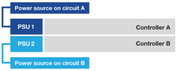

= Ligue o hardware dos sistemas de storage EF50 e EF80
:allow-uri-read: 
:icons: font
:imagesdir: ../media/

[role="lead"]
Após conectar os cabos do seu sistema de storage EF50 ou EF80, você liga as prateleiras, atribui IDs às prateleiras (se aplicável) e liga os controladores.

.Antes de começar
Tome precauções antiestáticas.

[[step-1-power-on-the-shelves-and-assign-shelf-ids]]
== Passo 1: ligue as prateleiras e atribua IDs às prateleiras

Ligue os compartimentos e, em seguida, atribua IDs exclusivos a cada compartimento.

.Sobre esta tarefa
* Atribuir um ID de compartimento exclusivo a cada compartimento garante que ele seja distinto dentro do seu sistema de storage.
+
Um ID de compartimento válido é de 01 a 99.

+
As prateleiras internas (storage), que estão integradas nos controladores, recebem um ID de prateleira fixo de 00.

* Você deve reinicializar o compartimento (desligue o interruptor de energia em cada uma das fontes de alimentação do compartimento SAS, aguarde pelo menos 10 segundos e, em seguida, ligue novamente) para que o ID do compartimento entre em vigor.

.Passos
. Ligue a prateleira conectando primeiro os cabos de força à prateleira, fixando-os no lugar com o suporte de cabo de força, conectando os cabos de força a fontes de energia em circuitos diferentes e, em seguida, ligando o interruptor de alimentação em cada uma das fontes de alimentação (na parte traseira da prateleira).
+
A prateleira liga e inicializa automaticamente quando ligada à energia.

. Remova a tampa da extremidade esquerda para acessar o botão laranja de identificação do compartimento no painel frontal.
+
image::../media/drw_shelf_id_sas_ieops-2187.svg[Alterar ID do compartimento SAS]

+
[cols="20%,80%"]
|===

 a| 
image::../media/icon_round_1.png[Chamada número 1]
 a| 
Tampa da extremidade da prateleira

 a| 
image::../media/icon_round_2.png[Chamada número 2]
 a| 
Placa frontal do compartimento

 a| 
image::../media/icon_round_3.png[[Chamada número 3]
 a| 
Botão de identificação da prateleira

 a| 
image::../media/icon_round_4.png[[Chamada número 4]
 a| 
Número de identificação da prateleira

|===
. Altere o primeiro número do ID do compartimento:
+
.. Pressione e mantenha pressionado o botão de identificação do compartimento de expansão até que o primeiro número no visor digital pisque e, em seguida, solte o botão.
+
O número pode demorar até 15 segundos para piscar. Isso ativa o modo de programação do ID do compartimento.

+

NOTE: Se o indicador de identificação demorar mais de 15 segundos para piscar, pressione e segure o botão de identificação do compartimento novamente, certificando-se de pressioná-lo completamente.

.. Pressione e solte o botão de identificação do compartimento para avançar o número até atingir o número desejado de 0 a 9.
+
Cada ciclo de pressionamento e liberação pode durar apenas um segundo.

+
O primeiro número continua piscando.

. Altere o segundo número do ID do compartimento:
+
.. Pressione e mantenha pressionado o botão até que o segundo número no visor digital pisque.
+
Pode levar até três segundos para o número piscar.

+
O primeiro número no visor digital para de piscar.

.. Pressione e solte o botão de identificação do compartimento para avançar o número até atingir o número desejado de 0 a 9.
+
O segundo número continua piscando.

. Confirme o número desejado e saia do modo de programação pressionando e mantendo pressionado o botão de identificação do compartimento de expansão até que o segundo número pare de piscar.
+
Pode levar até três segundos para o número parar de piscar.

+
Os dois números no visor digital começam a piscar e o LED âmbar acende após cerca de cinco segundos, alertando você de que o ID do compartimento pendente ainda não entrou em vigor.

. Desligue e ligue o compartimento por pelo menos 10 segundos para que o ID do compartimento entre em vigor.
+
.. Desligue o interruptor de alimentação de cada uma das fontes de alimentação.
.. Aguarde 10 segundos.
.. Ligue o interruptor de alimentação em cada uma das fontes de alimentação para concluir o ciclo de energia.
+
Quando a fonte de alimentação é ligada, o LED bicolor deve acender em verde.

. Recoloque a tampa da extremidade esquerda.

[[step-2-power-on-the-controllers]]
== Passo 2: Ligue os controladores

Depois de ligar as prateleiras e atribuir IDs únicos a elas, ligue os controladores.

. Conecte um cabo de alimentação em cada fonte de alimentação do controlador e, em seguida, conecte-os a fontes de energia em circuitos diferentes.
+

NOTE: Se você estiver usando unidades de distribuição de energia (PDUs) de terceiro, não use tomadas elétricas diretamente atrás dos controladores, pois isso pode bloquear o acesso aos controladores.

+
*Cabos de alimentação*

+

+

+
** O sistema começa a inicializar. A inicialização inicial pode levar até oito minutos.
** Os LEDs no chassi do sistema piscam e as ventoinhas ligam, o que indica que os controladores estão sendo ligados.
+
Durante a inicialização é normal que as ventoinhas façam muito barulho.

** O visor digital na parte frontal do chassi (atrás do painel) não acende.

. Prenda os cabos de alimentação usando o dispositivo de fixação em cada fonte de alimentação.

.O que se segue?
Após ligar o seu sistema de storage, link:install-complete-setup.html["configuração completa do sistema de storage"].
